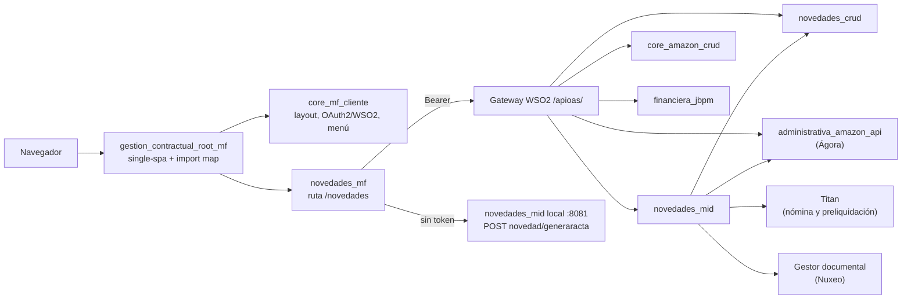
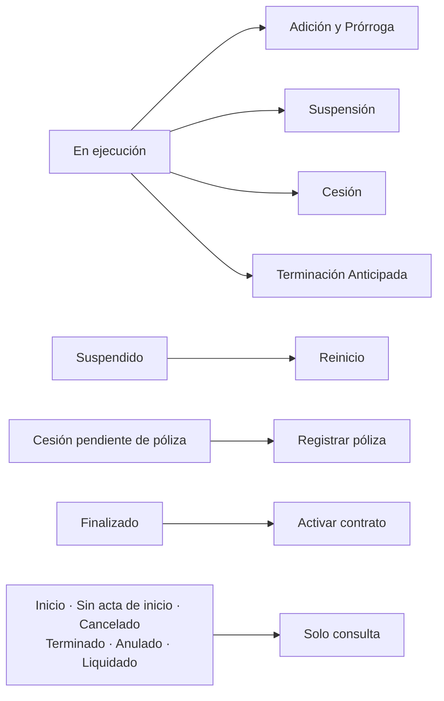
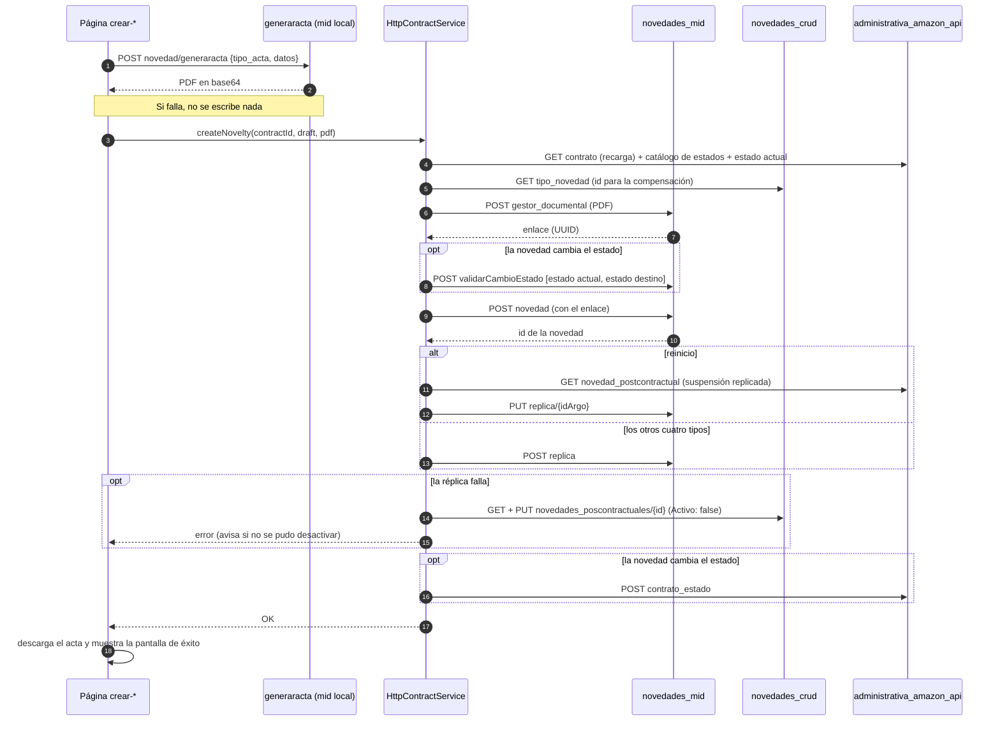

# Manual técnico — novedades_mf

Manual para quien instala, mantiene, despliega o extiende el microfrontend de novedades
poscontractuales. Explica cómo está construido, cómo se ejecuta y cómo se integra con el shell
y con las APIs institucionales, qué hace cada servicio del backend con lo que recibe, y dónde
tocar para cada tipo de cambio.

Documentos relacionados, que este manual no repite:

| Documento | Para qué |
|---|---|
| [README](../README.md) | Ficha del repositorio con el formato institucional |
| [ARCHITECTURE.md](ARCHITECTURE.md) | Capas, flujos y ciclo de vida, en diagramas |
| [adr/](adr/) | Una decisión de arquitectura por archivo, con su contexto y sus consecuencias |
| [SEGURIDAD.md](SEGURIDAD.md) | Validación de seguridad previa al despliegue: SonarQube, dependencias, checklist |
| [MANUAL_USUARIO.md](MANUAL_USUARIO.md) | Uso funcional, pantalla por pantalla |

Si este manual contradice el código, manda el código.

## Contenido

1. [Qué es y qué cubre](#1-qué-es-y-qué-cubre)
2. [Tecnologías y versiones](#2-tecnologías-y-versiones)
3. [Estructura del repositorio](#3-estructura-del-repositorio)
4. [Puesta en marcha local](#4-puesta-en-marcha-local)
5. [Ambientes, compilación y despliegue](#5-ambientes-compilación-y-despliegue)
6. [Integración con single-spa](#6-integración-con-single-spa)
7. [Arquitectura por capas](#7-arquitectura-por-capas)
8. [Modelo de dominio y reglas de negocio](#8-modelo-de-dominio-y-reglas-de-negocio)
9. [Integración con el backend](#9-integración-con-el-backend)
10. [Generación y consulta del acta](#10-generación-y-consulta-del-acta)
11. [Seguridad](#11-seguridad)
12. [Manejo de errores](#12-manejo-de-errores)
13. [Interfaz y estilos](#13-interfaz-y-estilos)
14. [Estado y reactividad](#14-estado-y-reactividad)
15. [Calidad: pruebas, lint y análisis estático](#15-calidad-pruebas-lint-y-análisis-estático)
16. [Cómo extender y mantener el módulo](#16-cómo-extender-y-mantener-el-módulo)
17. [Solución de problemas](#17-solución-de-problemas)
18. [Limitaciones y decisiones pendientes](#18-limitaciones-y-decisiones-pendientes)
19. [Cumplimiento de los lineamientos OAS](#19-cumplimiento-de-los-lineamientos-oas)
20. [Glosario](#20-glosario)
21. [Índice de decisiones (ADR)](#21-índice-de-decisiones-adr)

---

## 1. Qué es y qué cubre

`novedades_mf` reescribe en Angular 18 el módulo legal del cliente `novedades_cliente`
(AngularJS 1.7.9, Grunt y Bower, dentro del cliente monolítico Argo), que gestiona las novedades
sobre contratos ya suscritos de la Universidad Distrital Francisco José de Caldas. El legado no
tenía ruta de actualización incremental, así que es una reescritura
([ADR-001](adr/ADR-001-reescritura-angular18.md)). Sus requerimientos se levantaron leyendo el
código del legado, no su documentación, que listaba funciones que no existían y omitía otras que
sí.

Es un microfrontend: no tiene login, layout ni menú propios. Se monta en la ruta `/novedades` del
shell `gestion_contractual_root_mf`, y `core_mf_cliente` pone el layout, la autenticación y el
menú.

Funciones del módulo:

| Función | Escribe en el backend |
|---|---|
| Buscar contratos por número o por documento del contratista, con su vigencia | No |
| Ver la ficha del contrato, su estado y sus novedades registradas | No |
| Crear Adición y Prórroga, Suspensión, Reinicio, Cesión y Terminación Anticipada | Sí, con acta en PDF |
| Previsualizar el acta antes de registrar | No |
| Registrar la póliza del cesionario tras una cesión | Sí |
| Ver el acta archivada de una novedad | No |
| Anular una novedad | Sí |
| Activar (reabrir) un contrato finalizado | Sí |

Funciones que el legado no tenía: búsqueda por contratista con autocomplete, filtro de vigencia
"Todos", cláusula adicional en todas las novedades y considerando adicional en la cesión,
previsualización del acta, valores en letras en resúmenes y actas, y pantallas de error con
código, servicio de origen y texto para reportar a soporte.

**Fuera del alcance**, a propósito:

| Qué | Por qué |
|---|---|
| Liquidación, Otrosí aclaratorio y modificatorio, consulta transversal de novedades, plantillas o minutas, seguimiento financiero | En el legado eran prototipos sin lógica ni backend. Hay que especificarlos con negocio antes de construirlos |
| Registro presupuestal (RP), reportes SpagoBI | Se asumen en otros microfrontends |
| Login, menú y notificaciones | Son del core |
| Saldos presupuestales | Los calcula el backend (`SaldoCdp`); el cliente no los reimplementa |

El módulo **no persiste nada propio**: todo dato vive en las APIs institucionales
([sección 9](#9-integración-con-el-backend)).



## 2. Tecnologías y versiones

| Pieza | Versión | Nota |
|---|---|---|
| Angular (core, router, forms, common) | 18.2 | Fijo: no se sube el framework ni se usan APIs posteriores ([ADR-001](adr/ADR-001-reescritura-angular18.md)) |
| Angular Material / CDK | 18.2 | Solo `MatIcon` y `MatAutocomplete` |
| single-spa / single-spa-angular | ≥ 4 / 9.2 | Ciclo de vida del microfrontend |
| `@angular-builders/custom-webpack` | 18.0 | Build UMD con la configuración de single-spa-angular |
| TypeScript | 5.5 | `strict`, `strictTemplates`, `noImplicitOverride`, `noPropertyAccessFromIndexSignature` |
| RxJS | 7.8 | HTTP y composición de la cascada de escritura |
| TailwindCSS | 3.4 | Con tokens propios y Preflight apagado |
| zone.js | 0.14 | Solo para las pruebas: la aplicación es *zoneless* |
| ESLint + angular-eslint | 9 / 18.4 | Configuración *flat*, también revisa plantillas y accesibilidad |
| Karma + Jasmine | 6.4 / 5.2 | Pruebas unitarias en Chrome |

**Node.js**: 20 o 22 LTS. Angular 18 está soportado hasta Node 22. `npm install` acepta versiones
más nuevas, porque el campo `engines` del CLI dice `>=22.0.0`, y con Node 24 el proyecto compila y
pasa las pruebas, pero `ng version` lo marca `Unsupported`: no es una combinación que Angular
garantice.

**Gestor de paquetes**: npm, con el `package-lock.json` versionado.

## 3. Estructura del repositorio

```
novedades_mf/
├── angular.json               # build UMD, configuraciones production/development/test, deployUrl
├── extra-webpack.config.js    # webpack de single-spa-angular (+ silencia un aviso de style-loader)
├── tailwind.config.js         # tokens, important: 'novedades-mf', Preflight apagado
├── eslint.config.js           # reglas de TS, plantillas y accesibilidad
├── sonar-project.properties   # análisis SonarQube (fuentes, exclusiones, pruebas)
├── tsconfig*.json             # app, pruebas y base (strict)
├── docs/                      # documentación versionada (este manual, ADR, seguridad, usuario)
├── public/                    # assets estáticos
└── src/
    ├── main.single-spa.ts     # ÚNICO entry: ciclo de vida single-spa + arranque standalone
    ├── index.html             # solo para `ng serve` sin shell
    ├── styles.scss            # CSS global, todo bajo el bloque `novedades-mf { … }`
    ├── environments/          # URLs de las APIs por ambiente (nombres institucionales *_SERVICE)
    └── app/
        ├── app.config.ts      # providers: zoneless, router, HttpClient + interceptor, bindings de puertos
        ├── app.routes.ts      # rutas lazy y guard
        ├── app.component.*    # raíz <novedades-mf>
        ├── shared/            # transversal, sin lógica de negocio
        │   ├── auth/          #   sesión (claims del JWT) y guard de acceso
        │   ├── http/          #   interceptor Bearer y traducción de errores
        │   ├── ui/            #   átomos visuales (campos, modal, tarjetas…)
        │   ├── util/          #   fechas, plazos, moneda, montos en letras, base64
        │   └── soporte.ts     #   enlace a la mesa de ayuda (IRIS) de la pantalla de error
        └── domains/contratos/ # el único dominio, en cuatro capas
            ├── domain/        #   entidades, enums, reglas puras, puertos
            ├── application/   #   casos de uso y estado de la UI
            ├── infrastructure/#   implementaciones HTTP, DTOs y mappers
            └── presentation/  #   páginas y componentes
```

Las pruebas (`*.spec.ts`) viven al lado del archivo que prueban.

## 4. Puesta en marcha local

### 4.1 Requisitos

- Node.js 20 o 22 LTS y npm.
- Chrome o Chromium, para `npm test`.
- Acceso de red al gateway `autenticacion.portaloas.udistrital.edu.co`: incluso en local, el MF
  consume las APIs institucionales reales (no hay mocks).
- Para **crear novedades**: `novedades_mid` corriendo en local en el puerto 8081
  ([4.4](#44-generador-de-actas-local)). Sin él se puede consultar, pero ninguna novedad se puede
  registrar.

```bash
git clone https://github.com/udistrital/novedades_mf
cd novedades_mf
npm install
```

### 4.2 Solo el microfrontend (sin shell)

```bash
npm start            # http://localhost:4209, con environment.development.ts
```

`ng serve` sirve `src/index.html`, que contiene `<novedades-mf>`; `main.single-spa.ts` detecta
el elemento y arranca la aplicación por su cuenta. Sin el shell nadie hace el login, así que el
token se pone a mano en la consola del navegador, con un JWT válido del ambiente:

```js
localStorage.setItem('access_token', '<jwt>');
```

Luego se recarga la página. Las claves que se leen, en este orden, son `access_token`,
`id_token` y `token` ([11](#11-seguridad)). Para trabajar contra el ambiente de pruebas en vez
del local: `npm run start:test`.

### 4.3 Integrado con el shell

Se levantan tres procesos, cada uno en su repositorio:

```bash
# 1) Root: orquestador single-spa (http://localhost:4200)
git clone https://github.com/udistrital/gestion_contractual_root_mf
cd gestion_contractual_root_mf && npm install && npm start

# 2) Core: layout, login y menú (http://localhost:4201)
git clone https://github.com/udistrital/core_mf_cliente
cd core_mf_cliente && npm install && npm start

# 3) Este microfrontend (http://localhost:4209/main.js)
cd novedades_mf && npm start
```

El root registra el MF en su import map local como `"@udistrital/novedades-mf":
"//localhost:4209/main.js"` (`src/environments/environment.ts` del root) y lo monta en la ruta
`novedades` de su `microfrontend-layout.html`. Se entra por `http://localhost:4200/novedades`;
el core hace el login y deja el token en `localStorage`.

Desde `localhost`, el gateway puede responder **403 (`900908 Resource forbidden`)** a
`novedades_mid` por la restricción de origen. Si pasa, los casos que dependen del mid (historial de
novedades y escrituras) se prueban desde el dominio de pruebas, o cargando el MF local sobre ese
dominio con un *import-map-override* de single-spa.

### 4.4 Generador de actas local

El acta de cada novedad la produce `POST novedad/generaracta` de `novedades_mid`
([10](#10-generación-y-consulta-del-acta)), que todavía no está desplegado en ningún ambiente:
corre en local desde la rama `feature/actas` de ese repositorio.

```bash
git clone https://github.com/udistrital/novedades_mid
cd novedades_mid && git checkout feature/actas
make run             # http://localhost:8081: carga .env.local y ejecuta bee run
```

`.env.local` trae `BEEGO_RUNMODE=dev`, que hace que el CORS acepte cualquier origen local. En modo
producción el mid solo acepta `*.udistrital.edu.co`, y desde `localhost` el navegador vería
`status 0`.

`ACTAS_MID_SERVICE` apunta a `http://localhost:8081/v1/` en los tres ambientes. El acta se genera
**antes** de registrar la novedad, así que con el generador apagado el formulario falla en el
primer paso y no se escribe nada.

### 4.5 Probar los servicios sin la interfaz

**El generador de actas** no exige token. Un caso mínimo de suspensión, con datos ficticios:

```bash
curl -s -X POST http://localhost:8081/v1/novedad/generaracta \
  -H 'Content-Type: application/json' \
  -d '{
  "tipo_acta": "suspension",
  "datos": {
    "contrato": {
      "numero_contrato": "1234", "vigencia": 2026,
      "objeto_contrato": "PRESTAR SERVICIOS PROFESIONALES DE APOYO JURÍDICO",
      "valor_contrato": 30000000, "plazo": "DIEZ ( 10 ) MESES", "plazo_dias": 300,
      "fecha_suscripcion": "2026-01-25", "fecha_inicio": "2026-02-01", "unidad_ejecutora": 1,
      "contratista": { "nombre": "JUAN PÉREZ GÓMEZ", "documento": "1010101010" },
      "supervisor":  { "nombre": "MARÍA SUPERVISORA RUIZ", "documento": "2020202020" },
      "ordenador":   { "nombre": "ANA ORDENADORA CASTRO", "documento": "3030303030" }
    },
    "fecha_inicio_suspension": "2026-06-01", "fecha_fin_suspension": "2026-06-30",
    "motivo": "Cierre temporal de la sede por obras",
    "fecha_solicitud": "2026-05-20",
    "numero_oficio_supervisor": "OF-SUP-101", "fecha_oficio_supervisor": "2026-05-22",
    "numero_oficio_ordenador": "OF-ORD-202", "fecha_oficio_ordenador": "2026-05-26"
  }
}' | jq '{success, filename, metadata}'
```

Para ver el PDF: `jq -r .file_base64 | base64 -d > acta.pdf` sobre la misma respuesta. Casos
negativos que conviene repetir tras tocar `acta-payload.mapper.ts`, todos con 422:

| Cambio sobre un caso válido | `campo` del error |
|---|---|
| `tipo_acta` con guion (`adicion-prorroga`) | `tipo_acta` |
| Un `documento` numérico en vez de string | `datos` (estructura inválida) |
| `prorroga_dias` con decimales | `datos` |
| Una fecha con hora (`2026-06-01T00:00:00`) | `datos` |
| Adición mayor al 50 % del valor del contrato | `datos.valor_adicion` |
| Terminación cuyos tres valores no suman el valor del contrato | `datos.saldo_universidad` |

**Las APIs institucionales** se prueban con curl o Postman, con el token que el shell dejó en
`localStorage`:

```http
GET https://autenticacion.portaloas.udistrital.edu.co/apioas/novedades_mid/v1/novedad/{numero}/{vigencia}
Authorization: Bearer <access_token>
Accept: application/json
```

### 4.6 Contra qué datos se trabaja

Los tres archivos de `src/environments/` usan **las mismas URLs de API**
(`https://autenticacion.portaloas.udistrital.edu.co/apioas/...`), igual que el cliente legado.
Falta confirmar con Infraestructura si ese gateway atiende datos de pruebas o de producción.
Mientras tanto, **toda escritura se trata como real**, también desde `npm start`: crear, anular,
activar o registrar una póliza modifica contratos de verdad. Para probar escrituras se usan
contratos acordados con negocio, y se anota el número y la vigencia de cada uno.

## 5. Ambientes, compilación y despliegue

### 5.1 Variables de ambiente

Viven en `src/environments/`. Los nombres son institucionales y no se cambian.

| Variable | Servicio | Uso |
|---|---|---|
| `ADMINISTRATIVA_PRUEBAS_SERVICE` | `administrativa_amazon_api` (Ágora) | Contratos, proveedores, estados, actas de inicio, ordenadores, vigencias, registro replicado de la suspensión |
| `NOVEDADES_MID_SERVICE` | `novedades_mid` | Novedades por contrato, gestor documental, validación de estado, réplica, anulación |
| `NOVEDADES_SERVICE` | `novedades_crud` | Catálogo `tipo_novedad`, compensación, póliza |
| `CORE_AMAZON_SERVICE` | `core_amazon_crud` | Catálogo de entidades aseguradoras |
| `FINANCIERA_JBPM_SERVICE` | `financiera_jbpm` | CDP y CRP vigentes que imprime el acta |
| `ACTAS_MID_SERVICE` | `novedades_mid` local | `POST novedad/generaracta`; se elimina cuando el endpoint se despliegue |
| `TOKEN` | WSO2 | Configuración OAuth2 del ambiente. El MF no la usa para autenticar: el login lo hace el core |
| `production` | — | `true` solo en `environment.ts`; activa `enableProdMode()` |

Entre los tres archivos solo cambian `production` y el bloque `TOKEN` (client id y URLs de
redirección). Cualquier URL nueva entra a los tres archivos y, si lleva token, a la allowlist del
interceptor ([11](#11-seguridad)).

### 5.2 Configuraciones de compilación

| Ambiente | Archivo | `deployUrl` | Servidor local | Compilación |
|---|---|---|---|---|
| Producción | `environment.ts` | `https://novedades.portaloas.udistrital.edu.co/` | — | `npm run build` o `npm run build:prod` |
| Pruebas | `environment.test.ts` | `https://pruebasnovedades.portaloas.udistrital.edu.co/` | `npm run start:test` | `npm run build:test` |
| Local | `environment.development.ts` | `http://localhost:4209/` | `npm start` | `npm run watch` |

`npm run build` usa la configuración `production`, que es la predeterminada. El `deployUrl` es la
URL pública donde queda el bundle: el root importa `main.js` desde ahí y los chunks lazy se
resuelven contra ella, no contra el origen del shell ([ADR-010](adr/ADR-010-deployurl-por-ambiente.md)).
Los dos dominios públicos se tomaron de los ambientes del cliente legado. Si Infraestructura
asigna otros, `main.js` cargaría pero las rutas lazy fallarían: hay que cambiar el `deployUrl` de
`test` y `production` y escribir un ADR que reemplace a ADR-010.

### 5.3 Qué produce la compilación

```
dist/novedades-mf/
├── main.js          # bundle UMD "novedades-mf": ciclo de vida single-spa + estilos inyectados
├── *.js             # un chunk por página lazy
└── (assets de public/)
```

- `outputHashing: none` en todas las configuraciones: el import map apunta siempre a `main.js`.
- Los estilos no salen en un `.css`: single-spa-angular los empaqueta en el JS y los inyecta como
  `<style>` al montar ([13.1](#131-aislamiento-css-frente-al-shell)).
- Presupuestos de producción: bundle inicial aviso 500 kB y error 1 MB; estilos por componente
  aviso 2 kB y error 4 kB.
- `polyfills: []`: zone.js no se empaqueta ([6](#6-integración-con-single-spa)).
- `extra-webpack.config.js` silencia los avisos de `style-loader`, que single-spa-angular produce
  en cada compilación y no admiten acción: así un aviso nuevo sí se nota.

### 5.4 Despliegue

El MF se publica como **archivos estáticos**: no hay Dockerfile ni servidor propio. Pasos:

1. Compilar con la configuración del ambiente (`npm run build:prod` o `npm run build:test`).
2. Publicar el contenido de `dist/novedades-mf/` en la URL del `deployUrl` de ese ambiente, con
   CORS que permita al dominio del shell cargar los scripts. `main.js` tiene que quedar en la raíz
   de esa URL, no dentro de una carpeta `novedades-mf/`.
3. Registrar el MF en el import map del root de ese ambiente:
   `"@udistrital/novedades-mf": "https://<deployUrl>/main.js"`, más su entrada de menú en el core.
   Hoy solo el import map local del root lo tiene.
4. Antes de producción, cumplir [5.6](#56-lista-previa-a-producción) y [SEGURIDAD.md](SEGURIDAD.md).

Lo que hay que confirmar con Infraestructura antes del primer despliegue:

| Pregunta | Por qué importa |
|---|---|
| ¿Qué dominio sirve el bucket de cada ambiente? | Tiene que coincidir con el `deployUrl` ([5.2](#52-configuraciones-de-compilación)) |
| ¿En qué carpeta del bucket queda? (propuesta: `/argo/novedades_mf`, como `gestion_contractual_mf`) | Define `target` del pipeline |
| ¿Quién agrega la entrada al import map del root de pruebas y de producción? | Es otro repositorio |
| ¿Qué datos atiende el gateway de las URLs de API? | Ver [4.6](#46-contra-qué-datos-se-trabaja) |

### 5.5 Integración continua (propuesta)

El repositorio todavía no tiene pipeline. El de los microfrontends institucionales es Drone
(`hubci.portaloas.udistrital.edu.co`): Desarrollo crea el `.drone.yml` y solicita el registro, e
Infraestructura registra el repositorio con sus secretos. La propuesta para este repo es el
pipeline del proyecto guía (`solicitudes_sabaticos_mf`), con estos pasos:

| Rama | Qué corre |
|---|---|
| `feature/*`, `develop` | SonarQube + `npm run build` (solo compila) |
| `release/*` | SonarQube + `npm run build:test` + subida al bucket de pruebas |
| `master` | SonarQube + `npm run build:prod` + subida al bucket de producción |
| `hotfix/*` | Solo SonarQube |

Ajustes respecto al proyecto guía:

- **Ruta del build**: aquí es `dist/novedades-mf/`, no `dist/`. El paso de subida usa
  `source: dist/novedades-mf/**/*` y `strip_prefix: dist/novedades-mf/`; copiado literal, el bundle
  quedaría en `…/novedades_mf/novedades-mf/main.js` y el root no lo encontraría.
- **Destino**: `target: /argo/${DRONE_REPO_NAME}` (el guía usa `/sga/…`), sujeto a la respuesta de
  Infraestructura.
- **Imagen de Node**: `node:22-alpine`, la versión más nueva que soporta Angular 18
  ([2](#2-tecnologías-y-versiones)).
- Secretos que el pipeline nombra: `SONAR_HOST`, `SONAR_TOKEN`, `BUCKET_CLIENTES_TEST`,
  `BUCKET_CLIENTES_PROD`, `aws_access_key_id` y `aws_secret_access_key`.

Antes de subirlo se verifica sin Drone: que el YAML tenga los seis pasos, que los tres scripts de
compilación pasen dentro de la misma imagen sobre una copia limpia del repo, y que al aplicar
`source`/`strip_prefix` a mano `main.js` quede en la raíz. Cuando el pipeline corra, la sección
"Estado CI" del README pasa a mostrar los badges de Drone y de SonarQube.

### 5.6 Lista previa a producción

1. **Generador de actas desplegado** en `novedades_mid`, y el MF apuntando a él
   ([10.6](#106-cuando-generaracta-se-despliegue)). Con `ACTAS_MID_SERVICE` en `localhost`, un
   despliegue consulta bien pero no puede registrar novedades.
2. **Barrido del código**: sin URLs `localhost` en `src/` (salvo `environment.development.ts`) y
   cada comentario `ponytail:` revisado, para confirmar que su límite sigue siendo aceptable.
3. **Respuesta de negocio sobre la aprobación previa** ([18](#18-limitaciones-y-decisiones-pendientes)).
4. **Checklist de seguridad** de [SEGURIDAD.md](SEGURIDAD.md).
5. Las preguntas a Infraestructura de [5.4](#54-despliegue), respondidas.

## 6. Integración con single-spa

Diagrama del ciclo de vida en [ARCHITECTURE.md](ARCHITECTURE.md#integración-single-spa-y-ciclo-de-vida).
Las piezas que no se pueden romper:

| Pieza | Dónde | Por qué |
|---|---|---|
| Entry único que exporta `bootstrap`, `mount`, `unmount` | `src/main.single-spa.ts` | Es lo que el root invoca |
| Auto-arranque si existe `<novedades-mf>` en el DOM | `src/main.single-spa.ts` | Modo standalone con `ng serve`; en el shell el elemento lo crea single-spa al montar |
| Build UMD `libraryName: novedades-mf` | `angular.json`, `extra-webpack.config.js` | Formato que carga el import map |
| Selector raíz `novedades-mf` | `app.component.ts`, plantilla de `main.single-spa.ts` | El lineamiento pide que coincida con el nombre del MF |
| `APP_BASE_HREF = '/novedades'` | Solo en el arranque single-spa | Sin él, el router no reconoce el segmento del shell (error NG04002) |
| `polyfills: []` | `angular.json` | El root provee zone.js; esta app es zoneless ([ADR-003](adr/ADR-003-standalone-zoneless-signals.md)) |
| Plantilla `<novedades-mf />` sin `mat-typography` | `src/main.single-spa.ts` | Las reglas tipográficas de Material pisarían las utilidades de Tailwind |
| `getSingleSpaExtraProviders()` | `src/main.single-spa.ts` | Coordina el router de Angular con la navegación de single-spa |
| Ruta comodín `**` → `''` | `app.routes.ts` | Una URL desconocida bajo `/novedades` vuelve al panel en vez de dejar el outlet en blanco |

El shell no le pasa *props* al MF: la única comunicación es el token en `localStorage`.

## 7. Arquitectura por capas

Un dominio, `domains/contratos/`, con cuatro capas y una regla de dependencia:
`presentation → application → domain ← infrastructure`. El detalle está en
[ARCHITECTURE.md](ARCHITECTURE.md#capas-ddd) y en [ADR-004](adr/ADR-004-ddd-dominio-unico.md).
Lo que hay en cada capa:

| Capa | Archivos | Responsabilidad |
|---|---|---|
| `domain/models/` | `contract.entity.ts`, `novelty-draft.model.ts`, `contract-status.enum.ts`, `novelty-type.enum.ts`, `poliza.model.ts`, `assignee.model.ts`, `novelty-document.model.ts` | Entidades y tipos del negocio, sin Angular |
| `domain/` | `contract.rules.ts` | Reglas puras: estado efectivo, acciones, topes, fechas de fin, anulación, rol |
| `domain/repositories/` | `contract.repository.ts`, `acta-generator.repository.ts` | Los dos puertos, `IContractRepository` e `IActaGenerator` |
| `application/` | `contract-state.service.ts` | Estado de búsqueda y del contrato seleccionado, en signals |
| `application/` | `novelty.service.ts` | Crear, anular y activar |
| `application/` | `acta-generator.service.ts`, `acta-viewer.service.ts` | Generar, descargar y previsualizar el acta; abrir el acta archivada |
| `infrastructure/` | `http-contract.service.ts` | Implementa `IContractRepository`: lecturas y cascada de escritura |
| `infrastructure/` | `http-acta-mid.service.ts` | Implementa `IActaGenerator` contra `generaracta` |
| `infrastructure/dtos/` | `external-api.dto.ts` | DTOs laxos: la forma real, tolerante, de lo que responde el backend |
| `infrastructure/mappers/` | `contract.mapper.ts` | DTO → dominio (`toContract`, `toNoveltySummaries`, `toContractStatus`…) |
| `infrastructure/mappers/` | `novelty-payload.mapper.ts` | Dominio → payloads de escritura (único archivo que los arma) |
| `infrastructure/mappers/` | `acta-payload.mapper.ts` | Dominio → cuerpo de `generaracta` |
| `presentation/pages/` | `dashboard-contratos`, cinco `crear-*`, `crear-poliza`, `create-novelty-page.base.ts` | Pantallas |
| `presentation/components/` | acordeón del contrato, tarjetas, modales de confirmación y anulación, resultado, error, autocomplete de contratista, cláusula adicional | Piezas visuales que hablan del dominio |

Los dos bindings puerto → implementación viven solo en `app.config.ts`:

```ts
{ provide: IContractRepository, useClass: HttpContractService },
{ provide: IActaGenerator, useClass: HttpActaMidService },
```

Los puertos son clases abstractas, no interfaces, porque Angular las usa como token de inyección
([ADR-005](adr/ADR-005-repositorio-como-puerto.md)). Un componente nunca inyecta `HttpClient` ni
`HttpContractService`: lee y escribe a través del puerto o de un servicio de aplicación.

## 8. Modelo de dominio y reglas de negocio

### 8.1 El negocio en breve

La Universidad suscribe contratos, en su mayoría de prestación de servicios, con contratistas
(personas naturales o jurídicas). Durante la ejecución ocurren eventos jurídicos que los modifican:
se les agrega dinero o tiempo, se pausan, se transfieren a otra persona o se terminan antes de
tiempo. Cada evento es una **novedad poscontractual** y queda formalizado en un **acta**. Este MF es
la herramienta del área jurídica (vista "Seguimiento Legal") para consultar contratos y tramitar
esas novedades.

| Novedad | Qué hace |
|---|---|
| Adición y Prórroga | Aumenta el valor **y** extiende el plazo; las dos partes son obligatorias |
| Suspensión | Pausa la ejecución por un período, con motivo |
| Reinicio | Levanta la suspensión vigente |
| Cesión | Transfiere el contrato del contratista actual (cedente) a otro (cesionario); después falta registrar la póliza del cesionario |
| Terminación Anticipada | Liquidación bilateral antes del plazo |

El catálogo del backend tiene además "Prórroga en Tiempo" (`NoveltyType.EXTENSION`). El dominio la
reconoce al leer el historial, pero ningún formulario la produce.

Roles de negocio que llegan en el token: `ORDENADOR_DEL_GASTO`, `SUPERVISOR`, `ASISTENTE_JURIDICA`
y `CONTRATISTA`. El menú del core decide quién entra al módulo; dentro, la única restricción por
rol es la del supervisor ([8.10](#810-autorización-por-rol)).

### 8.2 Entidades

- **`Contract`**: contrato con sus datos maestros (número, vigencia, tipo, objeto, valor, plazo
  inicial, fechas, unidad de ejecución), contratista, supervisor y ordenador del gasto con su
  documento, cargo y resolución, y la lista de novedades. `id` es el compuesto
  `${numero}_${vigencia}`, porque el backend no tiene un id único de contrato y un mismo número se
  repite en vigencias distintas. `principalId` es el `Id` de la fila de `contrato_general`, que es
  lo que piden los endpoints de estado, el acta de inicio y la réplica.
- **`NoveltySummary`**: novedad registrada, como la devuelve el mid: id, tipo, estado del trámite,
  fechas, días de prórroga o suspensión, valor de adición, cesionario, número de póliza y enlace
  del acta.
- **`NoveltyDraft`**: unión discriminada por `type` con un miembro por tipo de novedad
  (`SuspensionDraft`, `ReinicioDraft`…). Es lo que arma el formulario y lo único que reciben los
  mappers de escritura. Sus campos van en español, como los del backend.

### 8.3 Estados del contrato

`ContractStatus` usa el nombre de negocio; el mapper normaliza el nombre crudo del backend, con o
sin tildes. Los ids son los del catálogo `estado_contrato` de Ágora (`ESTADO_CONTRATO_ID` en
`novelty-payload.mapper.ts`), confirmados con negocio.

| Catálogo (id) | `ContractStatus` | Se muestra como |
|---|---|---|
| Por Suscribir (1) | `INICIO` | Inicio |
| Suspendido (2) | `SUSPENDIDO` | Suspendido |
| Suscrito (3) | `SUSCRITO` | Sin acta de inicio |
| En Ejecución (4) | `EN_EJECUCION` | En ejecución |
| Anulado (5) | `ANULADO` | Anulado |
| Finalizado (6) | `FINALIZADO` | Finalizado |
| Cancelado (7) | `CANCELADO` | Cancelado |
| Finalizado(Anticipado) (8) | `TERMINADO` | Terminado (Anticipado) |
| Liquidado (9) | `LIQUIDADO` | Liquidado |
| Novedad Anulada (10) | — | Transitorio: el mid lo atraviesa al anular y no queda como estado actual |
| — | `CESION_PENDIENTE_POLIZA` | Cesión pendiente de póliza |

- Para mostrar un estado se usa siempre `contractStatusLabel`, porque dos etiquetas difieren del
  enum.
- "Cesión pendiente de póliza" **no existe en el catálogo** y la cesión no registra cambio de
  estado, así que Ágora sigue diciendo "En ejecución". Se deriva de que la última novedad sea una
  cesión sin número de póliza (`assignmentPendingPoliza`), y por eso `effectiveStatus` la evalúa
  antes que el estado del backend.
- Si `contrato_estado` no tiene registro, el estado se infiere de las novedades: suspendido si la
  última es una suspensión; si no, en ejecución.
- La "última novedad" es la de **mayor `id`**, no la de fecha más reciente (`getLatestNovelty`):
  el id es autoincremental, y varias novedades del mismo día empatan en fecha.

### 8.4 Estados de una novedad

| Estado | Código en el backend | Efecto |
|---|---|---|
| En trámite | `ENTR` | Bloquea toda acción sobre el contrato |
| En ejecución | `ENEJ` (en el campo `Estado`: 4569) | Novedad vigente |
| Terminada | `TERM` (4519) | Ya cumplió su fecha de fin efectiva |

El paso de `ENEJ` a `TERM` no lo hace el cliente ni la réplica: lo hace un temporizador del mid que,
cada 30 minutos, recorre las novedades en ejecución y termina las que ya alcanzaron su
`fechafinefectiva`. El cliente **no debe** tocar ese estado: el único endpoint que lo permitiría
(`PUT {mid}novedad/{id}`) escribe la cadena `"TERMINADA"` en vez del código numérico y rompería la
lectura del estado. Por lo mismo, tras un reinicio la suspensión sigue "En ejecución" hasta que
corra el temporizador.

### 8.5 Acciones por estado

`availableActions(contract)` decide qué ofrece el menú del contrato. El guard de las rutas usa la
misma función, así que menú y URL no pueden divergir.



Una novedad **En trámite** bloquea todas las acciones. Los valores de `ContractAction` son los
segmentos de ruta (`adicion-prorroga`, `suspension`, `cesion`, `terminacion`, `reinicio`,
`poliza`, `activar`); `accionDeRuta` los lee directamente de la URL.

### 8.6 Reglas de negocio

Todas son funciones puras en `domain/contract.rules.ts`, probadas en `contract.rules.spec.ts`.

| Función | Regla |
|---|---|
| `currentContractValue` | Valor vigente = valor base + todas las adiciones registradas |
| `currentTermDays` | Plazo vigente en días = plazo inicial (mes = 30 días) + prórrogas registradas. Las suspensiones no lo alargan |
| `contractEndDate` | Fin vigente = fin del acta de inicio + días de prórroga + días de suspensión. Sin acta de inicio cargada se aproxima desde el inicio y el plazo |
| `maxAdditionValue` | Tope de adición: 50 % del valor vigente (`TOPE_ADICION`) |
| `maxExtensionDays` | Tope de prórroga: 50 % del plazo vigente en días, truncado (`TOPE_PRORROGA`) |
| `maxEarlyTerminationDate` | Última fecha de terminación anticipada: un día antes del fin vigente |
| `terminationImbalance` | Valor vigente − (desembolsado + saldo del contratista + saldo de la universidad); la liquidación cuadra en 0 |
| `activeSuspension` | La suspensión que un reinicio reanuda: la última novedad, si es suspensión |
| `assignmentPendingPoliza` | La cesión sin póliza que bloquea el contrato |
| `currentContractorId` | Contratista vigente: el último cesionario, si hubo cesiones |
| `availableVigencias` | Respaldo de vigencias si Ágora no responde: del año actual hacia atrás hasta 2015, el primer año con contratos |
| `canAnnulNovelty` | Reglas de anulación ([8.9](#89-anulación)) |
| `canManageContract` | Regla de rol ([8.10](#810-autorización-por-rol)) |

La búsqueda siempre exige un criterio (número o contratista): el universo de contratos es
demasiado grande para listarlo.

### 8.7 Validaciones de cada formulario

Además de los campos obligatorios:

| Novedad | Validaciones y campos derivados |
|---|---|
| Adición y Prórroga | Valor ≥ 1 y ≤ tope de adición; días ≥ 1, enteros y ≤ tope de prórroga. Al superar el tope, el valor en letras desaparece y "Nuevo Valor" y "Nuevo Plazo" se quedan en el máximo. El número de CDP es texto: es un identificador y puede llevar letras y guiones |
| Suspensión | Inicio ≥ inicio del contrato + 1 día; fin > inicio (período mínimo de 1 día) y ≤ fin vigente, que es su valor por defecto; motivo de hasta 249 caracteres (el tamaño de la columna en el backend). Período y fecha de reinicio (fin + 1) son derivados, de solo lectura |
| Reinicio | Precarga las fechas de la suspensión vigente. El fin de la suspensión va de su inicio + 1 día hasta el fin registrado en ella, que es su valor por defecto; período y fecha de reinicio derivados |
| Cesión | El cesionario tiene que elegirse de la lista del autocomplete (persona natural). Fecha de cesión ≤ fin vigente; valores ≥ 1 y ≤ valor vigente; días faltantes de pago enteros ≥ 1, opcionales. La terminación del cedente es la fecha de cesión − 1 día, y el saldo del cesionario, valor vigente − (favor del cedente + desembolsado), en rojo si es negativo |
| Terminación Anticipada | Fecha ≤ un día antes del fin vigente, que es su valor por defecto; los tres valores ≤ valor vigente y su suma igual al valor vigente. Los tres pueden ser mayores que cero a la vez; el saldo de la universidad se sugiere como el resto mientras el usuario no lo edite |
| Todas | Cláusula adicional opcional: al activarla, su texto pasa a obligatorio. En la cesión, lo mismo para el considerando adicional |

Los topes son constantes del dominio y el generador de actas los vuelve a validar: si no cuadran,
responde 422. Un valor por defecto se escribe en el control solo mientras siga `pristine`, para no
pisar lo que digitó el usuario.

### 8.8 Fechas y plazos

- **Mes = 30 días** en todo cálculo de plazos, también en las suspensiones
  ([ADR-012](adr/ADR-012-regla-mes-30-dias.md)). Negocio decidió mantener la regla del legado por
  paridad con el sistema en producción y con las actas ya emitidas. `DIAS_POR_MES` en
  `shared/util/format.util.ts` es el punto único a cambiar si jurídica se pronunciara en contra.
- **`periodDays(inicio, fin)`** cuenta los dos extremos con la regla de 30 días: del 10/02 al
  05/03 son 26 días, donde el calendario daría 24. Es la cuenta que el backend guarda y el acta
  imprime; no es `daysBetween`, que cuenta días de calendario.
- **`termToDays`** es la única lectura de un plazo ("NUEVE ( 9 ) MESES Y QUINCE ( 15 ) DÍAS"),
  y respeta la unidad de cada grupo. **`formatTerm`** es la única forma de mostrarlo: siempre en
  meses y días, con los meses aunque sean cero ("CERO ( 0 ) MESES Y VEINTICUATRO ( 24 ) DÍAS"). Ágora
  guarda cada plazo en la unidad con que se pactó; esa unidad solo sobrevive en los datos
  numéricos (`executionTerm`, `plazo_dias`). Los conteos que no son plazos de ejecución (período de
  una suspensión, días de pago al cedente) se muestran en días.
- **El acta de inicio es la fuente del período pactado** y nunca se actualiza: ni prórrogas ni
  suspensiones se ven en ella, por eso las suma `contractEndDate`. Calcular el fin desde el inicio
  y el plazo puede desviarse unos días del acta, y solo con el fin del acta cuadran las fechas que
  registra el backend.
- En el modelo, las fechas son `yyyy-mm-dd`. Para mostrarlas se usa `toDisplayDate` (dd/mm/aaaa) y
  para pedirlas, el átomo `app-date-input`, nunca `<input type="date">`: este dibuja el formato del
  idioma del navegador (mm/dd/aaaa en uno en inglés), y el usuario digitaría el día donde va el mes.
- **En el cable**, toda fecha viaja como mediodía de Bogotá (`bogotaNoonIso`, `…T17:00:00.000Z`).
  Enviar medianoche UTC correría el día hacia atrás al leerla en UTC−5. Es formato de transporte,
  no aritmética: el dominio no replica los parches de fecha del legado
  ([ADR-013](adr/ADR-013-normalizacion-fechas-legado.md)). La excepción es el `FechaRegistro` de
  `POST contrato_estado`, que lleva la marca de tiempo real.
- Los registros que el CRUD devuelve con la marca de tiempo por defecto de Go
  (`2026-08-24 14:00:26.032834 +0000 +0000`) se reescriben a ISO antes de reenviarlos
  (`conFechasIso`), porque el propio CRUD no los acepta de vuelta.

### 8.9 Anulación

Anular revierte un error de digitación reciente, no deshace historia jurídica. Se puede anular una
novedad solo si (`canAnnulNovelty`, [ADR-019](adr/ADR-019-anulacion-solo-con-una-novedad.md)):

1. el contrato tiene **una sola** novedad, y es esa;
2. su tipo corresponde al estado que produjo:

| Estado del contrato | Novedad anulable |
|---|---|
| Suspendido | Suspensión |
| Cesión pendiente de póliza | Cesión |
| Terminado o Finalizado | Terminación Anticipada |
| En ejecución | Adición y Prórroga, Reinicio o Cesión con póliza ya registrada |

Registrar la póliza no cierra la cesión, porque un error en el cesionario suele detectarse
después de asegurarla. Con dos o más novedades no se anula ninguna, tampoco la última. Ampliarlo
exige antes que el backend devuelva el contrato al estado previo a la novedad anulada, y no
siempre a "En ejecución".

### 8.10 Autorización por rol

`canManageContract(roles, documento, contrato)`: si el **único** rol de negocio del usuario es
`SUPERVISOR`, solo gestiona los contratos cuyo supervisor tiene su mismo documento (claim
`documento` del JWT); en los demás solo consulta. Con un rol de ordenador o de asistencia jurídica
no se exige la coincidencia. Se aplica en el acordeón (oculta las acciones) y en el guard. Es una
interpretación de la regla del legado, porque el shell no tiene selector de "rol activo". El
backend no valida el rol ([9.12](#912-defectos-conocidos-del-backend)).

## 9. Integración con el backend

### 9.1 Cómo responde cada servicio

**`novedades_mid`** (Go, Beego): orquesta. Todas sus rutas cuelgan de `/v1`.

- No tiene autenticación propia: reenvía la cabecera `Authorization` a los servicios que llama y
  asume que el gateway ya validó el token.
- Casi todo responde con el envoltorio `Alert`, `{Type, Code, Body}`, y **puede responder HTTP 200
  con `Type: "ERROR"`**. La anulación es la excepción: responde `{Success, Status, Message, Data}`
  (librería `utils_oas`).
- CORS: cualquier origen en modo desarrollo; `*.udistrital.edu.co` en producción.
- Un temporizador corre cada 30 minutos: termina las novedades vencidas ([8.4](#84-estados-de-una-novedad))
  y replica las pendientes.
- Llama por su cuenta a `novedades_crud`, Ágora, Titan (nómina y preliquidación) y el gestor
  documental (Nuxeo).

**`novedades_crud`, `administrativa_amazon_api`, `core_amazon_crud`** (Go, Beego, PostgreSQL):
CRUD genérico por recurso: `POST /`, `GET /`, `GET /:id`, `PUT /:id`, `DELETE /:id`. Parámetros de
listado:

| Parámetro | Uso | Por defecto |
|---|---|---|
| `query` | Filtro `campo:valor,campo:valor`, con notación de punto para relaciones (`ContratoSuscrito.NumeroContratoSuscrito:…`) y operadores (`__icontains`, `__lte`, `__gte`) | — |
| `fields` | Columnas a devolver | todas |
| `sortby` / `order` | Orden (`asc` o `desc`) | sin orden / `asc` |
| `limit` / `offset` | Paginación; `limit=0` devuelve todas las filas | **10** / 0 |

Un `PUT` **reemplaza el registro completo**, no hace merge: lo que no viaje en el cuerpo se borra.
Sin filas, varios recursos responden `[{}]` en vez de `[]`.

### 9.2 Capa anticorrupción

Esa forma de responder se absorbe solo en `infrastructure/` ([ADR-005](adr/ADR-005-repositorio-como-puerto.md)):

| Rareza del backend | Dónde se absorbe |
|---|---|
| Campos con nombres alternativos (`ValorContrato`/`Valor`, `VigenciaContrato`/`Vigencia`) | DTOs con ambos campos opcionales + `contract.mapper.ts` |
| Un campo que llega como número, como string o como objeto (`Contratista`, `TipoContrato`) | DTO con tipo unión + mapper |
| Datos de la novedad anidados en `NovedadPoscontractual` | El mapper lee del objeto desanidado (`item.NovedadPoscontractual ?? item`) |
| `[{}]` como "sin filas" | `nonEmpty()` en `http-contract.service.ts` |
| HTTP 200 con `Type: "ERROR"` | `esAlertaExitosa()`: el estado HTTP nunca basta |
| Respuesta de anulación en otra forma | `anulacionRechazada()`, que entiende las dos formas |
| Marcas de tiempo de Go que el CRUD no acepta de vuelta | `conFechasIso()` |
| `PUT` que reemplaza el registro | Compensación y póliza releen el registro y lo reenvían entero |

Reglas de un mapper: es una función pura `toXxx`, nunca lanza por un dato faltante (devuelve `''`,
`0` o `[]`) y no contiene reglas de negocio, solo traducción de forma. Si el dominio necesita un
`?? ''` para defenderse de un dato, el mapper quedó incompleto.

### 9.3 Lecturas

| Endpoint | Para qué | Si falla |
|---|---|---|
| `GET {adm}contrato_general/?query=ContratoSuscrito.NumeroContratoSuscrito:{n}[,VigenciaContrato:{v}]` | Buscar por número; cargar el detalle | Lista vacía |
| `GET {adm}informacion_proveedor?query=NumDocumento:{doc}` → `contrato_general?query=Contratista:{id}` | Buscar por contratista | Lista vacía |
| `GET {adm}informacion_proveedor?query=Id:{id}` | Nombre y documento del contratista y del último cesionario | Sin contratista |
| `GET {adm}informacion_proveedor?query=NumDocumento__icontains:{q}&limit=20` | Autocomplete de cesionario | Sin sugerencias |
| `GET {mid}novedad/{numero}/{vigencia}` | Novedades del contrato | Sin novedades |
| `GET {adm}contrato_estado?query=NumeroContrato:{principalId},Vigencia:{v}&sortby=Id&order=desc&limit=1` | Estado vigente | Estado inferido de las novedades |
| `GET {adm}acta_inicio?query=NumeroContrato:{principalId}` | Fechas reales de inicio y fin (solo detalle) | Fechas aproximadas |
| `GET {adm}ordenadores?query=IdOrdenador:{id},FechaInicio__lte:{f},FechaFin__gte:{f}` | Ordenador del gasto vigente al inicio del contrato | Sin ordenador |
| `GET {adm}vigencia_contrato` | Años del filtro y vigencia por defecto del CDP (cache por sesión) | Rango calculado ([8.6](#86-reglas-de-negocio)) |
| `GET {mid}gestor_documental/{enlace}` | Acta archivada, en base64 | Error visible |
| `GET {core}entidad_aseguradora?limit=0` | Aseguradoras de la póliza | Lista vacía |
| `GET {crud}poliza?query=IdNovedadesPoscontractuales:{id}` | Póliza que dejó la cesión | Sin póliza |
| `GET {adm}informacion_persona_natural?query=Id:{doc}` | Nombre de quien elabora el acta (cache por sesión) | El acta imprime `________` |
| `GET {adm}supervisor_contrato?query=DependenciaSupervisor:DEP636&sortby=FechaFin&order=desc&limit=1` | Jefe de la Oficina de Contratación, que aprueba el acta | El acta imprime `________` |
| `GET {jbpm}cdprptercerocontrato/{v}/{n}/{unidad:4 dígitos}/12` | CDP y CRP vigentes del acta | El acta imprime `________` |

`{adm}`, `{mid}`, `{crud}`, `{core}` y `{jbpm}` son, en ese orden, `ADMINISTRATIVA_PRUEBAS_SERVICE`,
`NOVEDADES_MID_SERVICE`, `NOVEDADES_SERVICE`, `CORE_AMAZON_SERVICE` y `FINANCIERA_JBPM_SERVICE`.

- Las **lecturas de apoyo toleran fallos** (una fila de contrato no se cae porque falle su estado).
  Los **prerrequisitos de una escritura no**: si uno falla, la novedad no se crea.
- Cada fila del listado cuesta tres peticiones en paralelo (proveedor, novedades y estado), más una
  si hubo cesión. Solo el detalle (`getContractById`) suma el acta de inicio y el ordenador, para no
  multiplicar peticiones por resultado.
- **Ordenador del gasto**: `contrato_general.OrdenadorGasto` trae un id numérico o `null`, nunca el
  nombre, y el ordenador cambia por período. Se resuelve encadenado: primero `acta_inicio` (fecha de
  inicio), luego `ordenadores` vigente a esa fecha. Con `null` no se hace la segunda petición y el
  contrato queda "sin ordenador asignado".
- **CDP y CRP**: el servicio devuelve el histórico en orden cronológico y el vigente es el último
  registro. El `12` final de la ruta es fijo y no está documentado: se copió del legado.
- **Gestor documental**: el mid responde el documento completo dentro del `Alert`: `file` (base64),
  `file:content["mime-type"]` y `dc:title`. No se usa `file:content.data`, que apunta a Nuxeo y
  exige su propia sesión.

### 9.4 Escrituras verificadas

Solo se escribe contra endpoints verificados con trazas reales del cliente legado o leyendo el
código del servicio, que cubre todos sus caminos de respuesta
([ADR-015](adr/ADR-015-cascada-completa-con-replica.md#escrituras-verificadas)). Cualquier otra
escritura va comentada con su razón.

| Escritura | Para qué |
|---|---|
| `POST {mid}gestor_documental` | Archivar el PDF del acta; devuelve el `enlace` (UUID) |
| `POST {mid}validarCambioEstado` (modo arreglo) | Validar la transición de estado, sin aplicarla |
| `POST {mid}novedad` | Crear la novedad |
| `POST {mid}replica` | Réplica hacia Ágora/Titan (cuatro tipos) |
| `PUT {mid}replica/{idArgo}` | Réplica del reinicio |
| `PUT {crud}novedades_poscontractuales/{id}` | Compensación de una réplica fallida |
| `POST {adm}contrato_estado` | Registrar el nuevo estado del contrato |
| `PUT {crud}poliza/{id}` | Completar la póliza tras una cesión |
| `PATCH {mid}novedad/{id}` | Anular una novedad |

Los payloads se arman **únicamente** en `infrastructure/mappers/novelty-payload.mapper.ts`, y
`novelty-payload.mapper.spec.ts` los fija campo por campo contra las trazas. Si el backend rechaza
un payload, ese es el único archivo a corregir.

### 9.5 Cascada de creación de una novedad

`HttpContractService.createNovelty` recarga el contrato (necesita su `principalId`, el id de
proveedor del contratista, la unidad y el plazo de ejecución) y ejecuta:



Antes del primer POST se verifica que el contrato traiga los datos que piden los payloads
(`datoDeContratoFaltante`: id principal, id de proveedor y documento del contratista, y la unidad
o el plazo de ejecución según el tipo) y, en una cesión, que el cesionario exista en
`informacion_proveedor`. Si falta algo, se corta con un mensaje que lo nombra.

Constantes por tipo (`NOVEDAD_BACKEND` y `TIPO_ACTA`):

| Novedad | `tipo_acta` | `tiponovedad` | Catálogo `tipo_novedad` | `estado` | Réplica | `TipoNovedad` de la réplica | Estado destino |
|---|---|---|---|---|---|---|---|
| Adición y Prórroga | `adicion_prorroga` | `NP_ADPRO` | Adición/Prórroga | `ENEJ` | `POST replica` | 220 | No cambia |
| Suspensión | `suspension` | `NP_SUS` | Suspensión | `ENEJ` | `POST replica` | 216 | Suspendido (2) |
| Reinicio | `reinicio` | `NP_REI` | Reinicio | `TERM` | `PUT replica/{idArgo}` | 216 | En ejecución (4) |
| Cesión | `cesion` | `NP_CES` | Cesión | `ENEJ` | `POST replica` | 219 | No cambia |
| Terminación Anticipada | `terminacion_liquidacion` | `NP_TER` | Terminación Anticipada | `TERM` | `POST replica` | 218 | Finalizado(Anticipado) (8) |

Solo las tres novedades con estado destino llaman `validarCambioEstado` y `contrato_estado`.

**La réplica** lleva la novedad a Ágora (`novedad_postcontractual`) y a Titan. `POST {mid}replica`
solo entiende cuatro códigos: 216 (suspender), 218 (cancelar, la terminación), 219 (ceder) y 220
(otrosí, la adición y prórroga). El reinicio no crea un registro: **actualiza** el de la suspensión
que reanuda, por eso va por `PUT {mid}replica/{id}`:

- El id es el del registro replicado en **Ágora**, no el de la novedad en `novedades_crud`: se
  busca con `GET {adm}novedad_postcontractual?query=numero_contrato:{n},vigencia:{v},TipoNovedad:216`,
  el más reciente por `FechaRegistro`. Si no aparece, se corta antes de llamar. El legado nunca lo
  resolvía y pedía `replica/undefined`.
- El mid **exige `TipoNovedad: 216`** en el cuerpo; con otro código responde 400.
- El mid copia el cuerpo a un `PUT {adm}novedad_postcontractual/{id}`, que reemplaza el registro,
  y luego avisa a Titan (`reiniciar_contrato`). Por eso se reenvían intactos `NumeroContrato`,
  `Vigencia`, `PlazoEjecucion`, `FechaInicio` y `UnidadEjecucion`; lo nuevo es `FechaFin` (fin de
  la suspensión) y `FechaReinicio`.

### 9.6 Detalles del cable por tipo

- `IdTipoDocumento: 38` es el acta de novedad en el gestor documental. El archivo se nombra
  `{prefijo}_{numero}_{año}{mes sin relleno}{día}{hora}{minuto}.pdf`, como en el legado.
- `validarCambioEstado` se llama en **modo arreglo** (`[estado actual, registro del estado
  destino]`), que solo valida. El modo objeto aplica el cambio por dentro y duplicaría el registro
  de `contrato_estado`.
- `NumeroContrato` en `contrato_estado` y en `validarCambioEstado` es el `principalId`, no el número
  del contrato. Confundirlos no falla: devuelve o escribe datos de otro contrato.
- `cesionario` viaja en **todos** los tipos, con el id de proveedor del contratista vigente. En la
  cesión se agrega `cedente` (el actual) y `cesionario` pasa a ser el nuevo.
- La réplica de la **terminación** es la única **sin `UnidadEjecucion`** (mandarla la hace fallar) y
  replica el plazo completo del contrato.
- La réplica de la **cesión** envía `PlazoEjecucion: 1` (inicio = fin = fecha de cesión), no los días
  faltantes del formulario, que son días por pagar al cedente.
- En **Adición y Prórroga**, `numerocdp` y `vigenciacdp` viajan como string, el oficio del
  supervisor como `"n.a."` y `numerorp`/`vigenciarp` como `"0"`.
- `fechafinefectiva`: el reinicio encadena la que dejó la suspensión y solo la corrige si el reinicio
  la acorta. Los otros cuatro tipos la derivan de las fechas de la propia novedad
  ([18](#18-limitaciones-y-decisiones-pendientes)).
- El usuario de los registros es `CC{documento}` del token, o `MID` si no hay documento.

### 9.7 Compensación y tiempos límite

- **Compensación**: si la réplica falla, `replicarOCompensar` relee la novedad recién creada y la
  reescribe con `Activo: false` y motivo "Error en la réplica". `TipoNovedad` viaja plano aunque el
  GET lo devuelva anidado. Si no pudo compensar (no se extrajo el id o el GET/PUT falló), el error
  al usuario lo dice: la novedad quedó **activa y sin replicar**, y hay que reportarlo antes de
  reintentar o quedará duplicada.
- **Tiempo límite de la cascada**: 60 s (`TIMEOUT_CASCADA_MS`), también para activar un contrato.
  Al vencer se cancela lo que falta, pero **no se deshace lo escrito**: si venció después del `POST
  novedad`, la novedad existe. Por eso el mensaje pide verificar antes de reintentar.
- **Tiempo límite del acta**: 30 s (`TIMEOUT_ACTA_MS`).
- La compensación vive en el cliente por fidelidad al legado, que tampoco tenía una transacción
  real, mientras el backend no ofrezca una. El día que exista, el punto único a retirar es
  `replicarOCompensar`.

### 9.8 Anulación

`PATCH {mid}novedad/{id}` con `{ usuario }` (si falta, el mid usa la cabecera `X-User` y, en último
caso, `MID`). Lo que hace el mid, en orden:

1. Registra en `contrato_estado` el estado 10 (Novedad Anulada) y luego el 4 (En ejecución), sin
   mirar el tipo de novedad.
2. Deja la novedad inactiva en `novedades_crud`.
3. Borra el registro replicado en Ágora y los contratos asociados en Titan.
4. Restituye el valor del contrato cuando corresponde y vuelve a replicar el período restituido.

Responde `{Success, Status, Message, Data}`, y en un fallo copia `Status` al código HTTP. Para el
reinicio, el paso 1 es incorrecto: anularlo revive la suspensión que había levantado. Por eso
`estadoTrasAnular` registra después `Suspendido` (2) con `POST contrato_estado`. Si esa segunda
escritura falla, el mensaje aclara que la anulación **sí** ocurrió y que hay que corregir el estado
antes de tramitar otra novedad.

### 9.9 Activación de un contrato finalizado

Valida la transición actual → "En ejecucion" con `validarCambioEstado` y registra el estado con
`POST contrato_estado`. No genera acta ni crea novedad.

### 9.10 Póliza tras una cesión

La cesión deja creado un registro en `poliza` sin número. `crear-poliza` lo busca por
`IdNovedadesPoscontractuales`, relee el registro completo y lo reenvía con `PUT {crud}poliza/{id}`
cambiando solo `NumeroPolizaId` y `EntidadAseguradoraId`. Nunca crea un registro y no genera acta.
Esta página no extiende `CreateNoveltyPage`, porque no hay borrador de novedad. Al registrar la
póliza, el contrato vuelve a "En ejecución" con sus cuatro novedades disponibles.

### 9.11 Respuestas de una creación

| Respuesta | Qué hace el cliente |
|---|---|
| `Alert` con `Type` distinto de `ERROR` y `Code` que no empieza por 4 ni 5 | Sigue al paso siguiente |
| `Alert` con `Type: "ERROR"`, aunque el HTTP sea 200 | Corta la cascada con "El servicio de novedades rechazó la operación (código …)" |
| Error HTTP | Corta la cascada; `describeApiError` lo traduce ([12](#12-manejo-de-errores)) |
| Respuesta del gestor sin un campo `Enlace` conocido | Busca cualquier UUID en el cuerpo (`extraerEnlace`) |

### 9.12 Defectos conocidos del backend

| Defecto | Efecto en el MF |
|---|---|
| La anulación revierte siempre a "En ejecución", sin mirar el tipo | El cliente corrige el estado tras anular un reinicio (`estadoTrasAnular`); es lo único a borrar el día que el mid lo arregle |
| Al reiniciar, la suspensión no pasa a terminada: solo la termina el temporizador | La suspensión se ve "En ejecución" hasta que llega su fecha de fin efectiva |
| El backend no valida que el estado del contrato admita la novedad en dos de los cinco tipos, ni el rol: el mid reenvía el token sin mirar sus claims | El guard y el menú son la única barrera, y se saltan llamando a la API directamente |
| El usuario de los registros lo envía el cliente, con el claim leído sin verificar la firma | Quien edite su `localStorage` lo altera. Lo correcto es que el backend lo tome del token validado |
| Fallos de réplica hacia Titan y Ágora (502 en la réplica, 504 en la anulación) | El cliente compensa y reporta |
| Las actas de novedades anteriores al 27–28 de agosto de 2026 se archivaron sin contenido (`file: ''`) | "Ver acta" falla en ellas |
| `POST {mid}registro_novedad` responde OK aunque falle la escritura | El MF no lo usa |
| `GET {mid}novedad/` sin parámetros no está implementado y `PUT {mid}novedad/{id}/{vigencia}` responde éxito pase lo que pase | El MF no los usa |
| `PUT` y `DELETE {crud}trNovedad/{id}` no hacen nada | El MF no los usa |

## 10. Generación y consulta del acta

### 10.1 Flujo

`ActaGeneratorService.generar` reúne lo que el acta imprime pero no sale del formulario, y llama
al puerto `IActaGenerator`:

1. **Firmantes** (`getActaResponsables`, cache por sesión): quien elabora (el usuario en sesión) y
   el jefe de la Oficina de Contratación, en nombre propio ("Laura Niño", no "LAURA NIÑO").
2. **CDP y CRP** (`getCdpRp`), solo para suspensión, cesión y terminación, que los imprimen en el
   encabezado. Adición y Prórroga usa el CDP que digita el usuario, y el reinicio no imprime
   ninguno. Esa consulta a `financiera_jbpm` es lenta y por eso no se hace en los demás tipos.
3. `POST {ACTAS_MID_SERVICE}novedad/generaracta` con `{ tipo_acta, datos }`.

Ninguna de las dos consultas previas falla: son campos opcionales del acta, que imprime su
marcador `________` cuando no llegan. El generador sí puede fallar, y entonces **no se registra
la novedad** ([ADR-018](adr/ADR-018-acta-antes-de-la-novedad.md)). El PDF se archiva en el gestor
documental dentro de la cascada, y se descarga en el equipo del usuario solo cuando el registro
terminó bien.

### 10.2 El contrato de `generaracta`

Es un endpoint **sin estado**: no consulta Ágora ni otro backend, no persiste nada y no valida
token. El PDF se arma en memoria con lo que llega en `datos`.

**`tipo_acta`** (con guion bajo; otro valor da 422):

| `tipo_acta` | Novedad | Código de formato (versión 02) |
|---|---|---|
| `suspension` | Suspensión | GC-PR-014-FR-054 |
| `reinicio` | Reinicio | GC-PR-014-FR-053 |
| `adicion_prorroga` | Adición y Prórroga | GC-PR-014 |
| `cesion` | Cesión | GC-PR-014-FR-052 |
| `terminacion_liquidacion` | Terminación Anticipada | GC-PR-014-FR-057 |

**Tipos JSON estrictos.** Un tipo equivocado en cualquier campo invalida todo `datos` con un solo
422 (`campo: "datos"`, "estructura inválida"):

| Clase | Campos | En JSON |
|---|---|---|
| Texto | `numero_contrato`, todo `documento`, oficios, solicitudes, plazos en letras, nombres | string |
| Entero | `vigencia`, `plazo_dias`, `cdp_vigencia`, `unidad_ejecutora`, `tamano_letra`, `prorroga_meses`, `prorroga_dias` | entero, sin decimales |
| Dinero | `valor_contrato`, `valor_adicion`, `valor_desembolsado`, `valor_a_favor`, `saldo_contratista`, `saldo_universidad` | número o string decimal |
| Fecha | todo `fecha_*` | `YYYY-MM-DD` exacto; `""` y `null` cuentan como ausente |

Los campos desconocidos se ignoran sin error: un nombre mal escrito simplemente no llega.

**Bloque `contrato`** (obligatorio en las cinco): `numero_contrato`, `vigencia` (1990–2100),
`objeto_contrato`, `valor_contrato` (> 0, el **vigente**: es la base del tope del 50 % y del
balance), `plazo` en letras, `fecha_suscripcion`, `fecha_inicio` y `contratista` son obligatorios.
Opcionales: `tipo_contrato` (por defecto "Contrato de Prestación de Servicios"), `plazo_dias`,
`cdp_numero`, `rp_numero`, `cdp_vigencia`, `unidad_ejecutora` (por defecto 1, Oficina de
Contratación), `supervisor` y `ordenador`.

**Persona**: `nombre` y `documento` (string) obligatorios; `tipo_documento` (por defecto "C.C."),
`ciudad_documento` (por defecto "Bogotá"), `rol` (el cargo que se imprime), `resolucion` (solo el
ordenador) y `apellidos` (solo el cesionario). Personas que exige cada acta:

| Acta | `contratista` | `supervisor` | `ordenador` | Otra |
|---|:-:|:-:|:-:|---|
| `suspension` | ✅ | ✅ | ✅ | |
| `reinicio` | ✅ | ✅ | — | |
| `adicion_prorroga` | ✅ | — | ✅ | |
| `cesion` | ✅ | ✅ | ✅ | `cesionario` |
| `terminacion_liquidacion` | ✅ | ✅ | ✅ | |

**Comunes**, opcionales, en la raíz de `datos`: `fecha_expedicion_acta` (por defecto hoy),
`elaboro`, `jefe_juridica_nombre`, `nueva_clausula` (se imprime como última cláusula numerada) y
`tamano_letra` (1–50, por defecto 10). El texto del usuario se escapa: `&` o `<` no rompen el PDF.

**Por acta** (lo que el servicio calcula no se envía; si llega, se ignora):

| Acta | Campos obligatorios | Reglas y cálculos del servicio |
|---|---|---|
| `suspension` | `fecha_inicio_suspension`, `fecha_fin_suspension`, `fecha_solicitud`, oficios del supervisor y del ordenador con su fecha; `motivo` opcional | Inicio ≥ inicio del contrato; fin ≥ inicio. Calcula el reinicio = fin + 1 |
| `reinicio` | `suspension_previa.{fecha_acta, fecha_inicio_suspension, fecha_fin_suspension}`; `fecha_reinicio` opcional | Reinicio > inicio de la suspensión; sin él, fin + 1 |
| `adicion_prorroga` | `valor_adicion`, `prorroga_meses` o `prorroga_dias`, `numero_oficio`/`fecha_oficio`, `numero_solicitud`/`fecha_solicitud`; `nuevo_plazo_contrato` opcional | Adición > 0 y ≤ 50 % de `valor_contrato`; al menos uno de los dos de prórroga > 0. Sin `nuevo_plazo_contrato` imprime "{plazo} más {prórroga}". Calcula el nuevo valor total |
| `cesion` | `cesionario`, `fecha_cesion`, `fecha_terminacion_cedente`, `valor_desembolsado`, `valor_a_favor`, `plazo_cedente`, `dias_pago_cedente` y `plazo_cesionario` (en letras), oficio del supervisor con su fecha, `fecha_solicitud`; `nuevo_considerando` opcional | Valores ≥ 0 y desembolsado + a favor ≤ `valor_contrato`. Calcula el valor del cesionario |
| `terminacion_liquidacion` | `fecha_terminacion_anticipada`, `valor_desembolsado`, `saldo_contratista`, `fecha_certificacion`, oficios del supervisor y del ordenador con su fecha, `fecha_efectos_legales`; `saldo_universidad` opcional | Desembolsado + saldo del contratista + saldo de la universidad = `valor_contrato` exacto; sin `saldo_universidad`, lo calcula como el resto |

La validación va en dos tandas: primero los campos del acta y sus reglas, y solo si pasan, el
bloque `contrato` y `tamano_letra`. Un 422 no siempre lista todos los errores a la vez.

**Respuesta 200**:

```json
{ "success": true,
  "filename": "acta_suspension_contrato_1234_2026.pdf",
  "file_base64": "JVBERi0x…",
  "metadata": { "tipo_acta": "suspension", "codigo_formato": "GC-PR-014-FR-054", "version_formato": "02",
                "numero_contrato": "1234", "vigencia": 2026, "fecha_generacion": "…", "size_bytes": 139869 } }
```

`file_base64` va sin prefijo `data:` y siempre es un PDF (empieza por `%PDF-`, `JVBERi` en base64).
Un acta pesa unos 140 kB, unos 187 kB en base64, por el escudo embebido.

**Errores** (sin envoltorio `Alert`):

| HTTP | Cuándo | Cuerpo |
|---|---|---|
| 400 | El cuerpo no es JSON | `{"success": false, "error": "JSON inválido"}` |
| 422 | `tipo_acta` no soportado, tipos JSON o reglas de negocio | `{"success": false, "error": "datos del acta inválidos", "detail": [{"campo": "datos.valor_adicion", "mensaje": "…"}]}` |
| 500 | Fallo al construir el PDF | `{"success": false, "error": "no fue posible generar el acta"}` |

`describeApiError` une los `detail` como `campo: mensaje`, sin el prefijo `datos.`.

### 10.3 Cómo arma `datos` el MF

Lo hace solo `acta-payload.mapper.ts`; con `http-acta-mid.service.ts`, son los dos únicos archivos
que conocen el generador.

- El bloque `contrato` lleva el valor y el plazo **vigentes** (con las novedades ya registradas),
  los mismos que usan los topes de los formularios.
- Los plazos van ya en letras, con `formatTerm`. En la cesión, el plazo del cedente es lo que
  ejecutó (inicio del contrato → su terminación) y el del cesionario lo que queda (fecha de cesión →
  fin vigente); los días de pago al cedente van en días, sin convertir a meses.
- La prórroga se envía en días (`prorroga_dias`) junto con `nuevo_plazo_contrato` ya compuesto.
- En la terminación, los tres saldos van tal como los digitó el usuario, aunque el servicio pudiera
  calcular el de la universidad: el acta es un documento legal y no imprime cifras que el usuario
  no aprobó. `fecha_efectos_legales` es el día siguiente a la terminación.
- Los opcionales que no se conocen **se omiten**, no se envían vacíos, para que el servicio imprima
  su marcador o su valor por defecto.
- `tamano_letra` se redondea a entero.

### 10.4 Previsualizar

`previsualizar` genera el acta con lo que hay en el formulario (que tiene que ser válido) y la
abre en otra pestaña como URL `blob:`, sin descargar archivo ni registrar nada. La pestaña se abre
**dentro del clic**, antes de la respuesta, para que el bloqueador de ventanas emergentes no la
descarte; si la generación falla, se cierra.

### 10.5 Ver el acta archivada

`ActaViewerService.open(enlace)` descarga el documento con `GET {mid}gestor_documental/{id}` y lo
abre en una pestaña, con el mismo truco de abrirla dentro del clic. Las URLs `blob:` se guardan en
una cache por página para no volver a pedir la misma acta. A propósito no se revocan, para que las
pestañas abiertas sigan funcionando.

### 10.6 Cuando generaracta se despliegue

El acoplamiento con el generador está contenido ([ADR-020](adr/ADR-020-acta-generada-en-novedades-mid.md)).
Cuando el endpoint esté en el mid desplegado (la rama `feature/actas` avanza a `develop` y a cada
ambiente):

1. En `http-acta-mid.service.ts`, cambiar la base `environment.ACTAS_MID_SERVICE` por
   `environment.NOVEDADES_MID_SERVICE`. La ruta relativa, `novedad/generaracta`, es la misma, porque
   las dos bases terminan en `/v1/`.
2. Borrar `ACTAS_MID_SERVICE` de los tres archivos de `src/environments/`.
3. Nada más: `NOVEDADES_MID_SERVICE` ya está en la allowlist del interceptor, así que la petición
   llevará el token que exige el gateway.

## 11. Seguridad

Detalle, análisis y checklist en [SEGURIDAD.md](SEGURIDAD.md). En resumen:

- **Autenticación delegada** ([ADR-009](adr/ADR-009-autenticacion-delegada.md)): el core ejecuta
  OAuth2 (flujo implícito) contra WSO2 y deja el token en `localStorage`. El MF nunca inicia el
  login.
- **Interceptor con allowlist** (`shared/http/auth.interceptor.ts`): agrega
  `Authorization: Bearer <token>` solo a las peticiones que empiezan por una de las cinco bases
  institucionales. El token se lee en **cada** petición, así que una renovación del shell se aplica
  sola. `ACTAS_MID_SERVICE` queda fuera a propósito: el generador local no valida token, y así el
  token no sale hacia `localhost`. El legado enviaba el token a todo.
- **Claims en el cliente** (`UserSessionService`): se decodifica el payload del JWT (`role` o
  `roles`, `documento`, `email`) **sin validar la firma**. Esos claims solo deciden qué muestra la
  UI. La autorización real la hace el gateway con el token.
- **Guard de rutas** (`contractAccessGuard`): para entrar a una ruta de novedad, el usuario tiene
  que poder gestionar el contrato (`canManageContract`) y el estado del contrato tiene que admitir
  esa acción (`availableActions`). Si no, vuelve al panel. Es una mejora sobre el legado, donde
  pegando la URL se abría cualquier formulario sobre cualquier contrato. No reemplaza al backend
  ([9.12](#912-defectos-conocidos-del-backend)).
- **Sin interruptores de prueba en la UI**: los caminos de error se prueban con fallos reales
  (servicio apagado, datos que el backend rechaza), nunca con banderas que llegarían al build de
  producción.
- **Sin secretos en el código**: los `CLIENTE_ID` de `environments/` son identificadores públicos
  de un flujo implícito, no secretos. El historial del repositorio no contiene tokens.

## 12. Manejo de errores

`describeApiError` (`shared/http/api-error.ts`) traduce cualquier error a
`{ code, detail, action, origen }`, que pintan la pantalla de error y el modal:

| Causa | `code` | Qué se le pide al usuario |
|---|---|---|
| La petición no salió (red, CORS, servicio apagado) | `SIN-CONEXION` | Revisar la conexión |
| 401 | `401-SESION` | Volver a iniciar sesión |
| 403 | `403-PERMISO` | Verificar su rol con la Oficina Asesora Jurídica |
| 404 | `404-NO-ENCONTRADO` | Volver al panel y buscar de nuevo |
| 409 | `409-CONFLICTO` | Revisar el estado actual en el panel |
| 400 / 422 | `400-DATOS` / `422-DATOS` | Revisar los datos del formulario |
| ≥ 500 | `{estado}-SERVIDOR` | Reintentar en unos minutos |
| Otro estado HTTP | `{estado}-HTTP` | Reintentar |
| `Error` lanzado por el repositorio | `OPERACION-RECHAZADA` | Su mensaje tal cual, ya escrito para el usuario |
| Sin rastro utilizable | `DESCONOCIDO` | Reintentar y reportar |

- Si el servicio manda un mensaje en el cuerpo (`Message`, `message`, `Error`, `error`, `Body` o
  `detail`), ese gana sobre el texto genérico del estado. Los cuerpos HTML, como la página de error
  de WSO2, se descartan.
- `origen` es el servicio y la ruta donde falló (`novedades_mid/v1/novedad`, o
  `localhost:8081/v1/novedad/generaracta`): le dice a soporte dónde mirar sin reproducir el trámite.
- `errorReportText` arma el bloque que el usuario copia para la mesa de ayuda IRIS: trámite,
  código, detalle, acción, servicio y fecha.
- Los mensajes del repositorio describen el estado en que quedó el sistema, no solo el fallo: "no
  se registró la novedad: falta…", "la novedad SÍ quedó anulada, pero…", "quedó registrada sin
  replicar…".

Dónde se maneja cada tipo de fallo:

| Situación | Patrón | Ejemplo en el código |
|---|---|---|
| Falla una consulta secundaria que no debe tumbar la principal | `catchError(() => of(valorNeutro))` en el repositorio | `novedadesDeContrato` |
| Falla la consulta principal de una vista | Signal de error en el servicio de estado, que la vista pinta | `ContractStateService.contractError` |
| Falla crear, anular o activar | Pantalla de error estándar con reintento | `CreateNoveltyPage.onConfirm` |
| Validación de formulario | `Validators` y errores propios que se agregan sin pisar los demás; el mensaje lo da `app-form-field` | `setExtraError` en `crear-suspension` |

Un `console.error` no es manejo de error: el usuario no ve la consola. Si una vista puede fallar,
su motivo va a un signal que la vista pinta.

## 13. Interfaz y estilos

### 13.1 Aislamiento CSS frente al shell

El MF comparte el DOM con el shell, sin Shadow DOM, y su CSS se inyecta de último: cualquier
selector sin ámbito ganaría los empates contra el shell. Ya pasó dos veces, con el Preflight de
Tailwind y con el tema precompilado de Material, que le partía el footer al shell
([ADR-017](adr/ADR-017-css-acotado-al-host.md)). Un mecanismo por cada fuente de CSS lo impide:

| Fuente | Mecanismo |
|---|---|
| Utilidades Tailwind | `important: 'novedades-mf'` en `tailwind.config.js`: cada utilidad sale como `novedades-mf .clase` |
| Reset de Tailwind (Preflight) | Apagado (`corePlugins.preflight: false`); su reemplazo acotado vive en `styles.scss` |
| Tema de Material | Mixins `mat.<componente>-theme` dentro del bloque `novedades-mf { … }`, en vez del tema precompilado |
| CSS propio | Escrito a mano dentro de `novedades-mf { … }` en `styles.scss` |
| Overlays del CDK | `ScopedOverlayContainer` monta el contenedor dentro del host, no en `<body>` |
| Apilamiento (`z-index`) | `isolation: isolate` en el host: nada del MF puede pintarse sobre el header del shell |

Las reglas de `html` y `body` del modo standalone viven en `src/index.html`, que nunca llega al
shell. Para auditar el CSS después de un cambio, el comentario de cabecera de `styles.scss` trae
los comandos: hay que compilar y comprobar que todo selector contenga `novedades-mf`, salvo las
dos excepciones inertes que documenta.

### 13.2 Tokens y componentes

- Colores, espaciados, radios y tipografía (Inter) solo con los tokens de `tailwind.config.js`:
  paleta granate y dorada (`primary`, `secondary`, `surface-*`, `error`…), espaciados
  (`stack-sm/md/lg`, `gutter`, `container-margin-*`) y escala tipográfica (`headline-lg`,
  `title-md`, `body-md`, `body-sm`, `label-sm`…). Sin valores arbitrarios (`text-[#333]`) si hay
  token; la excepción tolerada es el tamaño de los `mat-icon`.
- Clases repetidas tres o más veces con significado propio se vuelven un átomo o una directiva de
  estilo (como `FormInputDirective`), no un `@apply`.
- Material se usa solo para `MatIcon` y `MatAutocomplete`, con la paleta `azure` definida en
  `styles.scss`. Un componente Material nuevo necesita justificar por qué no basta un átomo, y su
  mixin de tema en el bloque del host.
- Las superficies son átomos propios de `shared/ui/`:

| Átomo | Uso |
|---|---|
| `app-card`, `app-modal-shell`, `app-feedback-card`, `app-toggle-section`, `app-breadcrumb` | Superficies y navegación |
| `app-form-field` + `appFormLabel` + `appFormInput` | Campo con etiqueta, error y estilo |
| `app-date-input` | Fecha dd/mm/aaaa; el valor del control es `yyyy-mm-dd` |
| `app-money-field` + `appMoneyInput` | Pesos enteros: se ve 1.500.000 y el control guarda 1500000 |
| `NoNegativeNumberDirective` | Sin selector propio: aplica a todo `input[type=number][min]` e impide negativos |
| `app-document-preview-control` | Tamaño de letra del acta y botón "Previsualizar Documento" |
| `app-novelty-form-actions` | Botones "Limpiar" y "Crear Novedad" del formulario |

### 13.3 Convenciones de formulario

- La etiqueta va en la plantilla de la página y el campo la proyecta:
  `<label appFormLabel for="id" [required]="…">Texto</label>` junto al control con ese `id`
  (`<span appFormLabel>` para un valor de solo lectura). Si la dibujara el átomo, el análisis
  estático marcaría cada input como "sin label", porque revisa cada plantilla por separado. Un
  `label="…"` sobre `app-form-field` compila, pero deja el campo sin etiqueta.
- Fechas siempre con `app-date-input`. Dinero siempre con `app-money-field`, nunca `type="number"`.
- Al enviar un formulario inválido, se marcan todos los controles y el foco va al primer campo
  inválido (`focusFirstInvalid`). Los errores se muestran mientras se escribe, sin esperar a salir
  del campo.
- Mínimos de accesibilidad que exige el lint: `label` asociado a su control, elementos con clic
  también operables por teclado, `aria-label` en navegaciones y roles de diálogo en los modales.

## 14. Estado y reactividad

- **Standalone, signals y zoneless** ([ADR-003](adr/ADR-003-standalone-zoneless-signals.md),
  [ADR-006](adr/ADR-006-estado-con-signals.md)): `provideExperimentalZonelessChangeDetection()`.
  La vista se actualiza cuando cambia un signal. Si no reacciona, el estado no es un signal; nunca
  se usa `detectChanges()`.
- `inject()` con campos `private readonly`; `input()`/`output()`/`model()`; control flow
  `@if`/`@for` con `track`. Sin NgModules, sin `CommonModule` (los pipes se importan sueltos) y sin
  `BehaviorSubject` como estado. Las suscripciones se cierran con `takeUntilDestroyed()`.
- `signal` para el estado propio, privado si es mutable; `computed` para todo lo derivado; `effect`
  solo para sincronizar con algo no reactivo. Sus dos usos legítimos aquí: escribir el valor por
  defecto de un `FormControl` cuando carga el contrato y subir el scroll al cambiar de vista sin
  navegar.
- **Formularios y signals**: para leer un formulario como signal,
  `toSignal(form.valueChanges, { initialValue: form.getRawValue() })`. Para derivar un control de
  otro (período, fecha de reinicio), se escucha `form.valueChanges`, no el del control fuente
  ([17.2](#172-trampas-conocidas-del-código)).
- RxJS sigue siendo el canal de entrada y salida (HTTP, `valueChanges`); los signals modelan el
  estado resultante.
- **`ContractStateService`** es un singleton que comparten el panel y las páginas de novedad.
  Guarda un signal privado y expone `computed` de solo lectura: `contracts`, `isLoading`,
  `error`, `filters`, `vigencias`, `selectedContract`, `isLoadingContract` y `contractError`. Sus
  acciones son `loadContracts(filters?)` y `loadContract(id)`.
- **`CreateNoveltyPage`** ([ADR-008](adr/ADR-008-clase-base-paginas-novedad.md)) lleva la máquina
  formulario → confirmando → éxito | error, la previsualización, el tamaño de letra y la vuelta
  al panel. Cada página aporta `noveltyName`, `form`, `buildDraft()`, `buildSummary()` y `onClear()`.
- Volver al panel lleva `?contrato={n}&vigencia={v}` en la URL, y el panel repite esa búsqueda al
  construirse (`restaurarUltimaBusqueda`): así el listado se repuebla aunque se haya recargado la
  página.
- Caches en memoria, que duran mientras dure la página: vigencias y firmantes del acta (por
  sesión, con `shareReplay`), y actas abiertas (URL `blob:` por documento).

## 15. Calidad: pruebas, lint y análisis estático

### 15.1 Comandos

```bash
npm test -- --watch=false --browsers=ChromeHeadless    # una corrida, sin ventana
npm test                                               # Chrome en modo observación
npx ng test --include='**/contract.rules.spec.ts' --watch=false --browsers=ChromeHeadless
npm run lint                                           # TS + plantillas + accesibilidad
npm run build                                          # build de producción
```

**Terminado** = `npm run lint` y `npm run build` en verde, y `npm test` en verde si se tocó lógica.

### 15.2 Pruebas automáticas

222 casos en 21 archivos (Karma + Jasmine). Las pruebas cargan zone.js en sus polyfills, aunque la
aplicación sea zoneless. La prioridad son las funciones puras y los mappers, donde está el riesgo
real (fechas, montos en letras, payloads); de los componentes solo se prueba la lógica de
formulario.

| Archivo | Casos | Qué fija |
|---|---|---|
| `contract.rules.spec.ts` | 42 | Estado efectivo, acciones por estado, anulación, acumulados, topes, fin vigente, balance de la terminación |
| `novelty-payload.mapper.spec.ts` | 31 | Payloads de novedad y réplica de los cinco tipos contra las trazas, campo por campo; fechas al mediodía de Bogotá |
| `acta-payload.mapper.spec.ts` | 24 | Cuerpo del acta por tipo, personas con su rol y opciones del documento |
| `format.util.spec.ts` | 22 | Letras, plazos con mes = 30 días, `periodDays`, casos borde de fecha |
| `http-contract.service.spec.ts` | 19 | Anulación en sus dos envoltorios, error de réplica, CDP/CRP, estado tras anular |
| `api-error.spec.ts` | 17 | Traducción de cada familia de error, servicio de origen y texto para soporte |
| `contract.mapper.spec.ts` | 15 | Plazo en meses y días, resumen de novedades, catálogo de estados, ordenador del gasto |
| `http-contract.service.http.spec.ts` | 7 | La cascada con `HttpTestingController`: orden, prerrequisitos, compensación, `Type: "ERROR"`, timeout, POST o PUT de la réplica |
| `crear-suspension`, `crear-reinicio` | 5 + 5 | Período y fin de la suspensión |
| `http-acta-mid.service.spec.ts` | 5 | Cuerpo por tipo y traducción del 422 del generador |
| `acta-viewer.service.spec.ts` | 5 | Cache, pestaña abierta dentro del clic, cierre al fallar |
| `create-novelty-page.base.spec.ts` | 4 | Vuelta al panel con el contrato |
| `create-novelty-page.acta.spec.ts` | 3 | El acta va antes de la novedad y su fallo aborta el trámite |
| `http-contract.service.vigencias.spec.ts` | 3 | Catálogo de vigencias y su respaldo |
| `contract-access.guard.spec.ts` | 3 | Acción que corresponde a cada ruta |
| `date-input.component.spec.ts`, `money-input.directive.spec.ts` | 3 + 3 | Formato dd/mm/aaaa y pesos enteros |
| `crear-cesion`, `acta-generator.service.spec.ts`, `app.component.spec.ts` | 2 + 2 + 2 | Derivados de la cesión, CDP/CRP solo donde se imprime, arranque |

Las pruebas HTTP usan `HttpTestingController`, no el backend: verifican qué se envía y cómo se
interpreta lo que vuelve. El `TestBed` de un componente con router necesita `provideRouter([])`.

### 15.3 Pruebas manuales de regresión

Las pruebas automáticas no tocan el backend real. Antes de entregar un cambio que afecte flujos,
se recorren estos casos con contratos acordados ([4.6](#46-contra-qué-datos-se-trabaja)), anotando
número, vigencia y resultado (pasa, falla o bloqueado) con evidencia:

| Área | Qué comprobar |
|---|---|
| Búsqueda | Sin criterio no busca y avisa; por número (exacto) y por contratista (autocomplete); vigencia y "Todos"; orden descendente por vigencia; mensaje sin resultados |
| Estado → acciones | Las acciones de cada estado ([8.5](#85-acciones-por-estado)); una novedad en trámite lo bloquea todo; una URL de novedad incompatible con el estado devuelve al panel |
| Formularios | Topes y derivados de cada novedad ([8.7](#87-validaciones-de-cada-formulario)); negativos imposibles de digitar; foco al primer error; cláusula adicional |
| Acta | Previsualizar abre otra pestaña sin descargar ni registrar; tamaño de letra aplicado; firmantes en nombre propio; CDP y CRP en suspensión, cesión y terminación; cargo y resolución del ordenador |
| Creación | Cada tipo de punta a punta: aparece en el historial, el estado del contrato cambia cuando corresponde y "Ver acta" abre el PDF |
| Cesión → póliza | Tras la cesión, el contrato queda pendiente de póliza; al registrarla, vuelve a "En ejecución" |
| Anulación y activación | Solo con una novedad; anular un reinicio devuelve el contrato a Suspendido; activar un finalizado lo deja en ejecución |
| Rol | Un supervisor solo gestiona sus contratos, también entrando por URL; los otros roles no tienen esa restricción |
| Errores | Con el mid local apagado, crear falla con `SIN-CONEXION` y no se escribe nada; un rechazo de negocio (HTTP 200 con `Type: "ERROR"`) muestra la pantalla de error, no un falso éxito; "Copiar error" trae trámite, código, detalle, servicio y fecha |

### 15.4 Lint y TypeScript

- `eslint.config.js`: recomendados de ESLint, typescript-eslint (`recommended` y `stylistic`) y
  angular-eslint, más plantillas y accesibilidad. Selectores con prefijo `app` (componentes en
  kebab-case, directivas en camelCase); el raíz es `novedades-mf`. La única excepción es
  `NoNegativeNumberDirective`, que se aplica sola y lleva su `eslint-disable` justificado. Un
  `output` no puede llamarse como un evento nativo (`dismiss`, no `cancel`).
- `tsconfig.json`: `strict`, `noImplicitOverride`, `noImplicitReturns`,
  `noFallthroughCasesInSwitch`, `noPropertyAccessFromIndexSignature` y, para Angular,
  `strictTemplates`, `strictInjectionParameters` y `strictInputAccessModifiers`.
- `.editorconfig`: formato común del repositorio.

### 15.5 SonarQube

`sonar-project.properties` analiza `src/`, excluye `*.spec.ts` y `*.scss` de las fuentes y toma
las pruebas de `**/*.spec.ts`. No declara cobertura (`lcov`): nada la genera hoy. Los resultados del
último análisis están en [SEGURIDAD.md](SEGURIDAD.md#3-análisis-de-código-sonarqube). Queda un
*code smell* a propósito: la expresión regular de `formatDocument`, sin riesgo real con números de
documento de pocos dígitos.

### 15.6 Convenciones de código

**Idioma**: tipos, clases y métodos en inglés. UI, segmentos de ruta y campos que viajan al
backend en español, como las APIs institucionales.

**Nombres de archivo**:

| Elemento | Convención | Ejemplo |
|---|---|---|
| Componente | `<nombre>.component.ts`, en carpeta propia si tiene plantilla externa | `contract-accordion/` |
| Átomo de `shared/ui` | Archivo suelto con plantilla inline | `money-field.component.ts` |
| Servicio | `<nombre>.service.ts` | `contract-state.service.ts` |
| Entidad, modelo, enum | `.entity.ts`, `.model.ts`, `.enum.ts` | `contract.entity.ts` |
| Reglas | `<dominio>.rules.ts` | `contract.rules.ts` |
| Puerto | `<nombre>.repository.ts`, clase `I<Nombre>Repository` | `contract.repository.ts` |
| DTO, mapper | `<origen>.dto.ts`, `<nombre>.mapper.ts` | `external-api.dto.ts` |
| Directiva | `<nombre>.directive.ts` | `form-input.directive.ts` |
| Carpetas | kebab-case; páginas con el verbo en español | `crear-cesion/` |

**Imports**, en este orden: Angular core y común; Angular forms, router y Material; RxJS; capas
externas propias; `shared/`; `domain/`. Rutas relativas, sin alias.

**Comentarios**: TSDoc breve sobre el **porqué**, en clases, entidades y funciones con contratos
no obvios; nada de comentarios de bitácora. Los comentarios `ponytail:` marcan una simplificación
deliberada con su límite conocido: se respetan o se resuelven, no se borran.

**Commits**: prefijo `feat:`, `fix:`, `docs:`, `test:` o `refactor:`, en ramas GitFlow
(`feature/*`).

**Anti-patrones** que se rechazan en revisión:

1. Un componente que inyecta `HttpClient` o `HttpContractService`.
2. Lógica de negocio en mappers, plantillas o componentes, en vez de `domain/`.
3. `BehaviorSubject` o `Subject` como estado de vista.
4. Un `effect` que deriva estado o encadena signals.
5. Estilos globales sin ámbito, o Preflight reactivado.
6. Un `output` con nombre de evento nativo.
7. URLs de API fuera de `environments/`.
8. `any` en código nuevo de dominio o aplicación (los DTOs laxos son la excepción acotada).
9. Abstracciones especulativas: interfaz con una sola implementación "por si acaso", fábrica sin
   segundo producto.
10. `console.log`, o un `console.error` en lugar de mostrarle el error al usuario.
11. `<input type="date">` nativo.

## 16. Cómo extender y mantener el módulo

La regla general es imitar lo que ya existe: una página de novedad nueva se parece a
`crear-suspension`, un endpoint nuevo a la cadena de búsqueda de contratos, un átomo nuevo a
`money-field`.

### 16.1 Una novedad nueva

1. Miembro nuevo en `NoveltyType` y en la unión `NoveltyDraft` (`domain/models/`).
2. Acción nueva en `ContractAction` (su valor es el segmento de ruta) y en `availableActions`, en
   el estado que la habilita. El menú del acordeón y el guard la toman de ahí.
3. Página `crear-<tipo>` que extiende `CreateNoveltyPage`, con `noveltyName`, `form`,
   `buildDraft()`, `buildSummary()` y `onClear()`. La plantilla se compone con
   `novelty-page-layout`, los átomos de [13.2](#132-tokens-y-componentes), `confirm-novelty-modal`,
   `novelty-result` y `novelty-error`.
4. Ruta lazy en `app.routes.ts`, como hija de `contratos/:contractId/novedades` y **antes** del
   comodín `**`.
5. Configuración en `NOVEDAD_BACKEND` y sus casos en `toNoveltyPayload` y `toReplicaPayload`
   (`novelty-payload.mapper.ts`), confirmados contra una traza real.
6. `tipo_acta` en `TIPO_ACTA` y su caso en `toActaPayload`, si el generador tiene plantilla.
7. Reglas nuevas como funciones puras en `contract.rules.ts`; cálculos de fechas y plazos con
   `shared/util/format.util.ts`.
8. Pruebas del payload campo por campo y de las reglas nuevas.

### 16.2 Una lectura nueva

1. La URL base, si es de un servicio nuevo: en los tres archivos de `environments/` con nombre
   `*_SERVICE`, y en `API_BASES` de `auth.interceptor.ts` si lleva token.
2. DTO laxo en `infrastructure/dtos/external-api.dto.ts`: todo opcional y con los nombres
   alternativos que el servicio use.
3. Mapper puro `toXxx` en `infrastructure/mappers/`, con su prueba ([9.2](#92-capa-anticorrupción)).
4. Método abstracto en el puerto y su implementación en `HttpContractService`, con `nonEmpty` y la
   tolerancia a fallos que corresponda ([12](#12-manejo-de-errores)).
5. Contra un CRUD Beego, un `limit` explícito cuando se esperan más de 10 filas: es el valor por
   defecto ([9.1](#91-cómo-responde-cada-servicio)).

### 16.3 Una escritura nueva

Igual que una lectura, y además:

1. Verificarla: una traza real del legado o la lectura del código del servicio que cubra todos
   sus caminos de respuesta.
2. Sumarla a la lista "Escrituras verificadas" de
   [ADR-015](adr/ADR-015-cascada-completa-con-replica.md#escrituras-verificadas).
3. Payload solo en `novelty-payload.mapper.ts`, fijado por una prueba.
4. Comprobar la respuesta con `esAlertaExitosa`, porque un error puede llegar con HTTP 200.
5. Si el recurso es de un CRUD Beego, releer el registro y reenviarlo completo: el `PUT` reemplaza.

### 16.4 Otros cambios

| Cambio | Dónde |
|---|---|
| Átomo visual nuevo | `shared/ui/` si no sabe nada del dominio; si habla de contratos, `presentation/components/`. Antes, revisar los existentes |
| Caso de uso nuevo | Servicio en `application/` que inyecta el puerto, nunca `HttpContractService` |
| Otro generador de actas | Nueva implementación de `IActaGenerator` y cambio del binding en `app.config.ts`; formularios y casos de uso no se tocan |
| Un dominio nuevo | Carpeta hermana `domains/<nombre>/` con las cuatro capas y su binding en `app.config.ts`; no mezclar otro negocio dentro de `contratos/` |
| Cambiar una decisión con ADR | ADR nuevo con `Estado: reemplaza a ADR-XXX`, nunca un cambio silencioso |
| Tope legal distinto | `TOPE_ADICION` / `TOPE_PRORROGA` en `contract.rules.ts`, con sus pruebas |

### 16.5 Mantenimiento previsto

| Cuando… | Hacer |
|---|---|
| `generaracta` se despliegue | [10.6](#106-cuando-generaracta-se-despliegue) |
| El mid devuelva el estado correcto al anular un reinicio | Borrar `estadoTrasAnular` y `estadoTrasAnulacion` (`http-contract.service.ts`); `annulNovelty` termina en el `PATCH` |
| El backend ofrezca una transacción entre Novedades y Ágora | Borrar `replicarOCompensar` y su compensación |
| Exista una API de parámetros normativos (topes, SMLMV) | Reemplazar las constantes `TOPE_*` por la consulta |
| Jurídica cambie la regla de mes = 30 días | `DIAS_POR_MES` y `periodDays`; afecta períodos de suspensión, topes de prórroga y plazos impresos en las actas |
| Haya una sexta copia del bloque "Datos de la Solicitud" en las páginas | Extraerlo a un componente; hoy hay cinco |
| Se migre a un Angular con soporte | Ver abajo |

**Migración de Angular.** `single-spa-angular` ya tiene soporte oficial para Angular 20 y 21. El
camino es un mayor por paso con `ng update`, verificando en cada uno. Cambios de código conocidos:
`provideZonelessChangeDetection` en `app.config.ts`, `provideSingleSpaPlatform` en
`main.single-spa.ts` y quitar `standalone: true`, que hace la migración de la versión 19; el resto
son dependencias. Exige un ADR que reemplace la regla "Angular 18 fijo" de ADR-001, y repetir la
verificación de las seis páginas y del acta. El momento de hacerlo es cuando Seguridad lo exija o
cuando el lineamiento de single-spa deje la versión 9.x de `single-spa-angular`.

## 17. Solución de problemas

### 17.1 Síntomas frecuentes

| Síntoma | Causa | Solución |
|---|---|---|
| `ng serve` falla con `Module not found` de un archivo que ya no existe | Cache de webpack indexada por nombre de archivo; `ng build` puede pasar igual, porque usa otra cache | `rm -rf .angular/cache` y volver a arrancar |
| `ng version` dice `Unsupported` junto a la versión de Node | Node más nuevo que lo que soporta Angular 18 | Usar Node 20 o 22 LTS |
| Toda petición responde 401 en modo standalone | No hay token en `localStorage` o venció | Poner un JWT vigente en `access_token` ([4.2](#42-solo-el-microfrontend-sin-shell)) |
| 403 `900908 Resource forbidden` desde `localhost` hacia `novedades_mid` | Restricción de origen del gateway | Probar desde el dominio de pruebas o con un import-map-override ([4.3](#43-integrado-con-el-shell)) |
| Error `NG04002` al montar en el shell | Falta `APP_BASE_HREF='/novedades'` | Revisar el arranque de `main.single-spa.ts` |
| El shell no carga el MF | El import map del root no tiene `@udistrital/novedades-mf`, o el `deployUrl` no corresponde al ambiente | Revisar el import map del root y [5.2](#52-configuraciones-de-compilación) |
| `main.js` carga pero las páginas no (chunks pedidos a otro dominio o a `localhost`) | Build con la configuración equivocada, o el dominio real no coincide con el `deployUrl` | Compilar con `build:prod` o `build:test`; si el dominio es otro, cambiar el `deployUrl` |
| Ninguna novedad se puede crear; el error muestra `localhost:8081/v1/novedad/generaracta` | El generador de actas local está apagado | Levantar `novedades_mid` ([4.4](#44-generador-de-actas-local)) |
| `SIN-CONEXION` solo contra `localhost:8081` | CORS del mid local fuera de modo desarrollo | Arrancarlo con `make run`, que carga `BEEGO_RUNMODE=dev` |
| 422 del generador con "estructura inválida" | Un tipo JSON equivocado en `datos` | Corregir `acta-payload.mapper.ts` ([10.2](#102-el-contrato-de-generaracta)) |
| 422 del generador por topes o por balance | Los valores no cuadran contra el valor o el plazo vigentes | Es un dato del usuario: revisar los valores |
| `500-SERVIDOR` en `novedades_mid/v1/gestor_documental` | Falla del gestor documental al archivar el acta | No queda nada registrado: reintentar más tarde; si persiste, reportar al equipo del mid |
| "Ver acta" falla en una novedad antigua | Se archivó sin contenido antes de finales de agosto de 2026 | No tiene arreglo desde el cliente ([9.12](#912-defectos-conocidos-del-backend)) |
| Tras un reinicio, la suspensión sigue "En ejecución" | El mid la termina con su temporizador al llegar la fecha de fin efectiva | Es el comportamiento esperado ([8.4](#84-estados-de-una-novedad)) |
| Error de réplica que dice que la novedad quedó registrada sin replicar | La compensación no pudo desactivarla | Reportarlo con el número de contrato antes de reintentar |
| Estilos del shell alterados con el MF montado | Un selector salió del bloque `novedades-mf` | Auditar el CSS con el procedimiento de `styles.scss` |
| El panel del autocomplete aparece sin estilos | Se quitó `ScopedOverlayContainer` o un mixin de tema | Revisar `app.config.ts` y el bloque del host en `styles.scss` |
| "Ver acta" o la previsualización no abren la pestaña | Bloqueador de ventanas emergentes | Permitir ventanas emergentes para el dominio |
| La vista no se actualiza tras un cambio | El estado que cambió no es un signal (app zoneless) | Convertirlo en signal o `computed`; nunca `detectChanges()` |

### 17.2 Trampas conocidas del código

Cada una ya causó un error real en este proyecto:

1. **`opacity` crea un contexto de apilamiento.** `disabled:opacity-50` pintaba botones encima del
   panel de filtros fijo. Se atenúa con color con transparencia (`disabled:text-error/40`).
2. **`<input type="number">` guarda un `number`**, aunque el tipo declare `string`. De ahí los
   `String(…)` explícitos en los payloads.
3. **`principalId` no es el número del contrato** ([9.6](#96-detalles-del-cable-por-tipo)).
4. **El orden de `ESTADOS_CONTRATO` importa** (`contract.mapper.ts`): `ANTICIPADO` va antes que
   `FINALIZADO`, porque "Finalizado(Anticipado)" contiene "FINALIZADO". Invertirlos lee toda
   terminación anticipada como un finalizado normal y ofrece "Activar contrato".
5. **Los campos de una novedad se leen por tipo.** Un nombre genérico como `Dias` servía a prórroga
   y a suspensión, y una suspensión inflaba el plazo vigente y los topes.
6. **Los campos de negocio se leen del objeto desanidado**, no del envoltorio: leerlos del
   envoltorio perdía el cesionario y la tarjeta seguía mostrando al contratista original.
7. **El ordenador del gasto es un id numérico**: tratarlo como nombre dejaba todos los contratos
   "sin ordenador" y bloqueaba la adición.
8. **Un `window.open` asíncrono lo bloquea el navegador**: la pestaña se abre dentro del clic y se
   llena después.
9. **Cambiar de vista por signal no sube el scroll**: `withInMemoryScrolling` solo actúa en
   navegaciones reales, así que esos cambios llevan su propio `window.scrollTo(0, 0)`.
10. **`ContractStateService` es singleton**: al volver al panel, el listado quedaría con datos
    viejos; por eso el panel repite la búsqueda al construirse.
11. **El período de una suspensión no se cuenta con el calendario** ([8.8](#88-fechas-y-plazos)): un
    error ahí se propaga al fin vigente, a los topes y a los valores por defecto siguientes.
12. **El `max` de `app-date-input` solo acota el calendario**, no lo que se escribe: cada tope de
    fecha necesita además su validador.
13. **`form.reset()` avisa control por control, en orden de declaración.** Un control derivado de
    otro declarado antes se recalculaba y enseguida el reset lo borraba: "Limpiar" dejaba período y
    fechas derivadas en blanco. Se deriva desde `form.valueChanges`, que avisa una sola vez al final.
14. **El label de un campo va en la página, no en el átomo** ([13.3](#133-convenciones-de-formulario)).

## 18. Limitaciones y decisiones pendientes

**Bloquean el paso a producción:**

- **Generador de actas sin desplegar.** `ACTAS_MID_SERVICE` apunta a `localhost:8081` en todos los
  ambientes ([10.6](#106-cuando-generaracta-se-despliegue)).
- **Aprobación previa, sin respuesta de negocio.** El legado tenía un módulo de aprobación de
  novedades por rol, con código roto (variables sin definir), que no sirve como especificación. Falta
  que negocio diga si el flujo vigente exige aprobar una novedad antes de crearla. Si la exige, hoy
  el módulo crea novedades saltándose ese control; es la única pregunta abierta que puede cambiar el
  alcance.

**Del diseño actual:**

- **Compensación en el cliente.** La consistencia entre `novedades_crud` y Ágora depende de que el
  navegador termine la cascada. Una pestaña cerrada a mitad de la réplica puede dejar una novedad
  sin replicar.
- **Fin efectivo aproximado.** Para cuatro de los cinco tipos, `fechafinefectiva` se deriva de las
  fechas de la propia novedad y del plazo vigente. El legado encadena el valor que dejó la novedad
  anterior; solo el reinicio está confirmado contra ese modelo (`ponytail:` en
  `novelty-payload.mapper.ts`).
- **Respuesta del gestor documental sin documentar.** `extraerEnlace` busca el UUID por los
  nombres conocidos y, como respaldo, en cualquier parte del cuerpo (`ponytail:` en
  `http-contract.service.ts`).
- **Anulación restringida** a contratos con una sola novedad ([8.9](#89-anulación)).
- **Rol interpretado** ([8.10](#810-autorización-por-rol)), y sin validación de rol ni de estado en el
  backend para dos de los cinco tipos ([9.12](#912-defectos-conocidos-del-backend)).
- **Topes como constantes** del dominio, no parametrizados desde el backend.
- **El valor `12` de la ruta de CDP/CRP** es fijo y su significado no está documentado.
- **La página de póliza** consulta el acta de inicio y el ordenador sin usarlos: los hereda de la
  carga de contrato que comparten las seis páginas, y separarla cuesta más de lo que ahorra.

**Pendientes de otros:**

- Confirmar qué datos atiende el gateway de las URLs de API ([4.6](#46-contra-qué-datos-se-trabaja)).
- Registro en Drone y respuestas de Infraestructura ([5.4](#54-despliegue), [5.5](#55-integración-continua-propuesta)).
- Paleta de Material: hoy es `azure`; los microfrontends de referencia toman la paleta de las
  variables `--md-primary-*` que publica el root. Falta validar si se exige. El impacto es acotado:
  Material solo pinta el panel del autocomplete y los iconos.
- Angular 18 ya no tiene soporte; la migración está planteada como trabajo futuro, sin fecha
  ([16.5](#165-mantenimiento-previsto)).
- Pronunciamiento formal de jurídica sobre la regla de mes = 30 días: negocio ya decidió mantenerla.

## 19. Cumplimiento de los lineamientos OAS

Los estándares institucionales están en el repositorio `udistrital/lineamientos_oas`, y el proyecto
guía de microfrontends es `udistrital/solicitudes_sabaticos_mf`.

**Se cumple como pide el lineamiento**: entry `main.single-spa.ts` con `bootstrap`/`mount`/`unmount`;
build con custom-webpack y single-spa-angular en UMD; selector raíz igual al nombre del MF;
`APP_BASE_HREF` con la ruta del root; `getSingleSpaExtraProviders()`; `provideHttpClient(withFetch())`;
zone.js provisto por el root; variables `*_SERVICE` institucionales y bloque `TOKEN`; tres ambientes
por `fileReplacements`; token compartido por `localStorage`; `deployUrl` por ambiente; puerto de
desarrollo propio con los scripts `build:single-spa:*` y `serve:single-spa:*`; etiquetas de commit y
ramas GitFlow; README con el formato institucional; licencia GPL-3.0; `sonar-project.properties`.

**Se aparta, con razón**:

| Decisión | El proyecto guía | Por qué |
|---|---|---|
| Standalone y `bootstrapApplication` | NgModules | API de Angular 18; single-spa-angular soporta ambas, con la misma integración |
| Zoneless | zone.js | El root sigue proveyendo zone.js para otros MF; este no lo necesita |
| DDD en cuatro capas | `components/`, `services/`, `managers/` | Ningún lineamiento fija la estructura interna; las reglas quedan aisladas y probables |
| Interceptor con allowlist que lee el token en cada petición | `RequestManager` que lo lee una vez | Soporta la renovación del token y no lo filtra a terceros |
| Repositorio abstracto, DTOs y mappers tipados | Servicios con `any` | Mismas URLs por ambiente, con tipado estricto |
| Modales y avisos propios (Tailwind) | sweetalert2 | No hay lineamiento de librería de diálogos |
| Sin guard de autenticación | Un guard que siempre devuelve `true` | Copiar un guard inerte no aporta; el guard de este MF sí bloquea por rol y estado |
| Sin i18n | ngx-translate | La UI de este dominio es monolingüe en español |
| Sin `empty-route` ni *props* del shell | Los conserva del scaffold | `empty-route` es para el core; las *props* no tienen consumidor |
| `environment.ts` es producción | `environment.ts` es local | Los tres ambientes existen y `production` es la configuración por defecto explícita |
| Tailwind con tokens propios y paleta de Material genérica | Tema SCSS con la paleta del sistema | Identidad visual del proyecto; la paleta de Material está pendiente de validar ([18](#18-limitaciones-y-decisiones-pendientes)) |
| Angular 18 | Versiones más nuevas | Al iniciar, Angular 18 era lo último que documentaban single-spa y el lineamiento ([ADR-001](adr/ADR-001-reescritura-angular18.md)) |
| Nombre `novedades_mf` | Convención `negocio_contexto` | Es el nombre institucional asignado, como `core_mf_cliente` |

## 20. Glosario

**Negocio**

| Término | Significado |
|---|---|
| Novedad poscontractual | Modificación jurídica formal sobre un contrato ya suscrito |
| Contrato | Acuerdo entre la Universidad y un contratista; se identifica por número y vigencia |
| Vigencia | Año fiscal del contrato; un mismo número se repite en vigencias distintas |
| Contratista | Persona natural o jurídica que ejecuta el contrato |
| Cedente / Cesionario | En una cesión, quien entrega el contrato / quien lo recibe |
| Supervisor | Responsable institucional que vigila la ejecución; sus oficios avalan las novedades |
| Ordenador del gasto | Autoridad que compromete presupuestalmente a la Universidad |
| Oficios | Comunicaciones numeradas y fechadas del supervisor y del ordenador que soportan la solicitud |
| Acta | Documento que formaliza una novedad; tiene fecha de expedición |
| Acta de inicio | Documento que fija el período pactado del contrato; nunca se actualiza |
| Fecha de fin efectiva | Cuándo termina de verdad lo que la novedad afecta; con ella el mid da la novedad por terminada |
| Plazo | Duración, en letras y números: "NUEVE ( 9 ) MESES" |
| Valor y plazo vigentes | Los iniciales más todas las adiciones y prórrogas registradas |
| CDP / CRP (RP) | Certificado de Disponibilidad Presupuestal / Registro Presupuestal |
| Póliza | Garantía del cesionario que cierra el trámite de una cesión |
| SMLMV | Salario Mínimo Mensual Legal Vigente |
| Seguimiento Legal | Nombre de la vista principal (el panel) en el área jurídica |
| Ágora | Sistema administrativo institucional (`administrativa_amazon_api`), donde se replican las novedades |
| Titan | Sistema de nómina y preliquidación al que el mid también replica |

**Técnico**

| Término | Significado |
|---|---|
| MF / microcliente | Microfrontend; "microcliente" en la jerga de la OAS |
| Root / shell | `gestion_contractual_root_mf`, que registra y monta los MF |
| Core | `core_mf_cliente`: layout, autenticación y menú por rol |
| Parcel | Aplicación single-spa empaquetada como UMD que el root importa |
| Id compuesto | `${numero}_${vigencia}`, la identidad de un contrato en rutas y consultas |
| `principalId` | `Id` de la fila de `contrato_general`; lo que piden los endpoints de estado |
| Puerto | Abstracción que el dominio define y la infraestructura implementa (`IContractRepository`, `IActaGenerator`) |
| Capa anticorrupción | DTOs y mappers que traducen el esquema laxo del backend al dominio |
| Draft | Objeto tipado (`NoveltyDraft`) que construye un formulario |
| mid / crud | Convención de la OAS: API de orquestación / API de persistencia |
| `Alert` | Envoltorio `{Type, Code, Body}` de casi todas las respuestas del mid |
| Réplica | Copia de la novedad hacia Ágora y Titan que hace el mid |
| Compensación | Desactivar la novedad recién creada cuando su réplica falla |
| WSO2 | Gateway y proveedor de identidad institucional; exige `Authorization: Bearer` |
| Zoneless | La app no usa zone.js para detectar cambios; reacciona por signals |
| Átomo | Componente visual genérico de `shared/ui/`, sin conocimiento del dominio |
| `deployUrl` | URL pública desde la que se resuelven los chunks del MF |
| OAS | Oficina Asesora de Sistemas de la Universidad Distrital |
| IRIS | Mesa de ayuda institucional, a la que el usuario reporta los errores |
| ADR | Architecture Decision Record, en [adr/](adr/) |
| `ponytail:` | Comentario que marca una simplificación deliberada y su límite conocido |

## 21. Índice de decisiones (ADR)

| ADR | Decisión | Estado |
|---|---|---|
| [001](adr/ADR-001-reescritura-angular18.md) | Reescritura completa en Angular 18 | Aceptada |
| [002](adr/ADR-002-parcel-single-spa.md) | Integración single-spa bajo `/novedades` | Aceptada |
| [003](adr/ADR-003-standalone-zoneless-signals.md) | Standalone, zoneless y signals | Aceptada |
| [004](adr/ADR-004-ddd-dominio-unico.md) | DDD por capas con dominio único `contratos` | Aceptada |
| [005](adr/ADR-005-repositorio-como-puerto.md) | Repositorio como puerto y capa anticorrupción | Aceptada |
| [006](adr/ADR-006-estado-con-signals.md) | Estado de UI con signals, sin NgRx | Aceptada |
| [007](adr/ADR-007-tailwind-tokens.md) | Tailwind con tokens; Material puntual; sin Preflight | Aceptada, completada por 017 |
| [008](adr/ADR-008-clase-base-paginas-novedad.md) | Clase base `CreateNoveltyPage` | Aceptada |
| [009](adr/ADR-009-autenticacion-delegada.md) | Autenticación delegada; interceptor con allowlist | Aceptada |
| [010](adr/ADR-010-deployurl-por-ambiente.md) | `deployUrl` por ambiente | Aceptada |
| [011](adr/ADR-011-escrituras-simuladas.md) | Escrituras simuladas en la primera fase | Reemplazada por 014 |
| [012](adr/ADR-012-regla-mes-30-dias.md) | Regla mes = 30 días | Aceptada |
| [013](adr/ADR-013-normalizacion-fechas-legado.md) | No replicar los parches de fecha del legado | Aceptada |
| [014](adr/ADR-014-escrituras-reales-sin-replica.md) | Escrituras reales sin réplica | Reemplazada por 015 |
| [015](adr/ADR-015-cascada-completa-con-replica.md) | Cascada completa con réplica y compensación | Aceptada |
| [016](adr/ADR-016-generacion-de-actas-desacoplada.md) | Acta detrás de un puerto | Aceptada; servicio reemplazado por 020 y orden por 018 |
| [017](adr/ADR-017-css-acotado-al-host.md) | Todo el CSS acotado al host | Aceptada |
| [018](adr/ADR-018-acta-antes-de-la-novedad.md) | El acta se genera antes de la novedad | Aceptada |
| [019](adr/ADR-019-anulacion-solo-con-una-novedad.md) | Anulación solo con una novedad | Aceptada |
| [020](adr/ADR-020-acta-generada-en-novedades-mid.md) | Acta con `generaracta` de `novedades_mid` | Aceptada |
