# Manual de usuario — Novedades poscontractuales

Módulo **Seguimiento Legal** del sistema de gestión contractual de la Universidad Distrital. Sirve
para consultar contratos suscritos y tramitar sus novedades: adición y prórroga, suspensión,
reinicio, cesión, terminación anticipada y el registro de la póliza del cesionario. Cada novedad
queda formalizada en un **acta** en PDF que el sistema genera y archiva.

## Contenido

1. [Ingreso y permisos](#1-ingreso-y-permisos)
2. [Buscar un contrato](#2-buscar-un-contrato)
3. [La ficha del contrato](#3-la-ficha-del-contrato)
4. [Qué se puede hacer según el estado del contrato](#4-qué-se-puede-hacer-según-el-estado-del-contrato)
5. [Cómo se crea una novedad (pasos comunes)](#5-cómo-se-crea-una-novedad-pasos-comunes)
6. [Adición y Prórroga](#6-adición-y-prórroga)
7. [Suspensión](#7-suspensión)
8. [Reinicio](#8-reinicio)
9. [Cesión](#9-cesión)
10. [Terminación Anticipada](#10-terminación-anticipada)
11. [Registrar la póliza del cesionario](#11-registrar-la-póliza-del-cesionario)
12. [Ver el acta de una novedad](#12-ver-el-acta-de-una-novedad)
13. [Anular una novedad](#13-anular-una-novedad)
14. [Activar un contrato finalizado](#14-activar-un-contrato-finalizado)
15. [Errores y soporte](#15-errores-y-soporte)
16. [Problemas frecuentes](#16-problemas-frecuentes)

## 1. Ingreso y permisos

- Ingrese al portal de gestión contractual con su usuario institucional y abra **Seguimiento Legal**
  desde el menú. En pantalla aparece la ruta **Seguimiento y Control › Seguimiento Legal**. El módulo
  no pide usuario ni contraseña propios: usa la sesión del portal.

  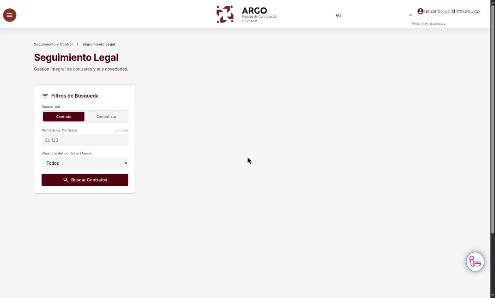

- Qué usuarios ven el módulo lo define la configuración de menús del portal.
- Dentro del módulo:
  - Si su único rol es **Supervisor**, solo puede tramitar y anular novedades de los contratos que
    usted supervisa. Los demás contratos los ve en modo consulta.
  - Los demás roles con acceso (ordenador del gasto, asistente jurídica) no tienen esa restricción.
- Si la sesión expira, el trámite falla con el código `401-SESION`: vuelva a iniciar sesión en el
  portal y repita la operación.

## 2. Buscar un contrato

La búsqueda siempre exige un criterio: el número del contrato o el contratista.

1. En **Buscar por**, elija **Contrato** o **Contratista**. Al cambiar de opción se borra lo que había
   escrito: nunca se busca por las dos a la vez.
2. Escriba el criterio:
   - **Número de Contrato**: el número completo. Un número parcial no trae resultados.
   - **Contratista**: escriba al menos 3 dígitos del documento. Aparece una lista con documento y
     nombre; al elegir uno, la búsqueda se hace sola.

     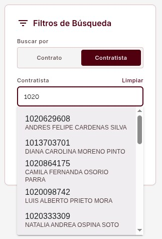

3. Opcional: en **Vigencia del contrato (Anual)** elija un año, o deje **Todos**.
4. Pulse **Buscar Contratos**. El enlace **Limpiar** borra el criterio.

Los resultados se ordenan del año más reciente al más antiguo. Si no hay coincidencias aparece
"No se encontraron contratos con los filtros aplicados.", y si pulsa buscar sin criterio, "Ingresa un
número de contrato o contratista para buscar."

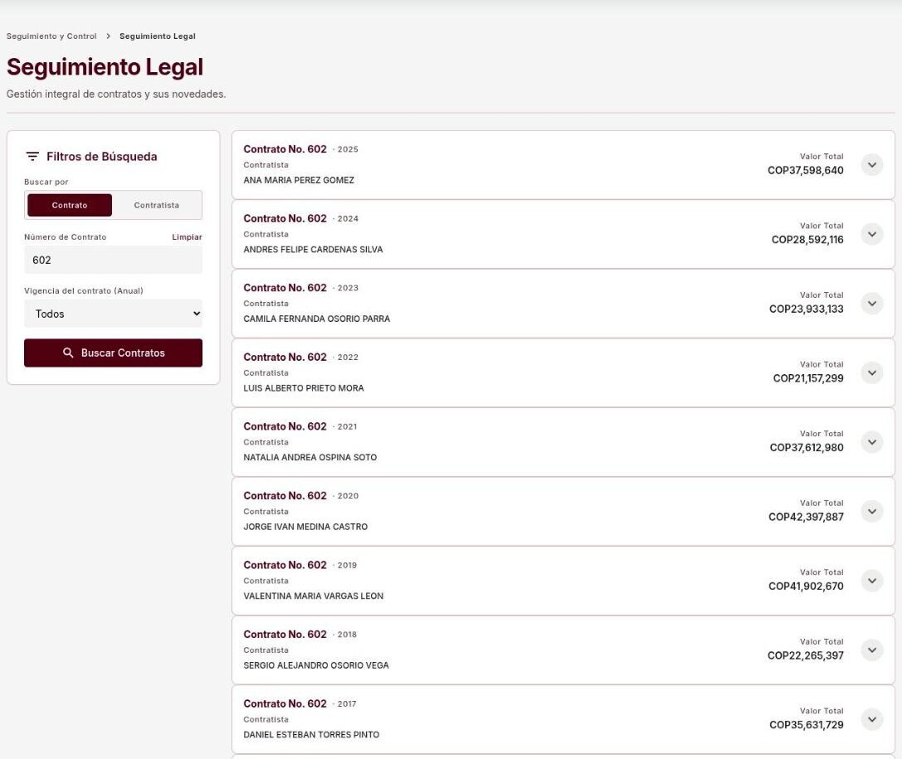

## 3. La ficha del contrato

Cada resultado es una ficha con el número, la vigencia, el contratista y el **Valor Total**. Al
pulsarla se despliega el detalle:

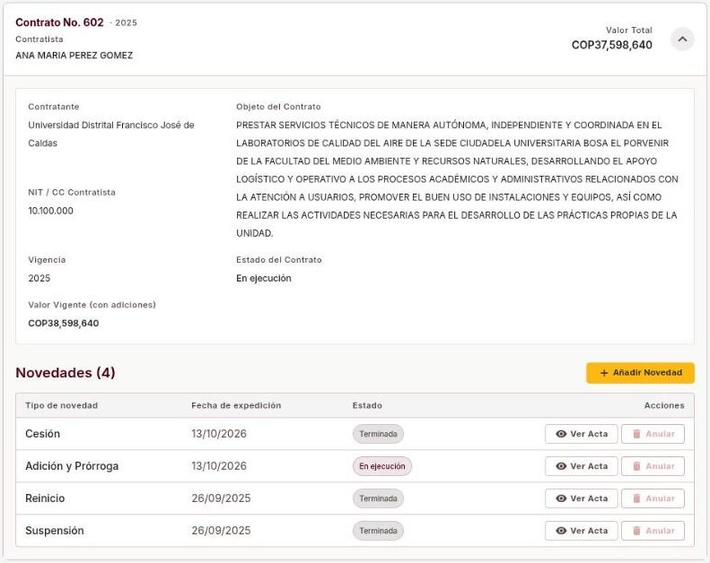

- **Contratante**, **Objeto del Contrato**, **NIT / CC Contratista**, **Vigencia** y **Estado del
  Contrato**.
- **Valor Vigente (con adiciones)**, si el contrato ya tuvo adiciones.
- Si el contrato fue cedido y falta la póliza del nuevo contratista, un aviso: "Contrato cedido sin
  póliza registrada."
- **Novedades (n)**: el historial, con tipo, fecha de expedición, estado y las acciones **Ver Acta**
  ([sección 12](#12-ver-el-acta-de-una-novedad)) y **Anular** ([sección 13](#13-anular-una-novedad)).
- El botón **Añadir Novedad**, con las acciones que el contrato admite hoy
  ([sección 4](#4-qué-se-puede-hacer-según-el-estado-del-contrato)).

Tras una cesión, el contratista que se muestra es el cesionario (el contratista vigente).

## 4. Qué se puede hacer según el estado del contrato

El menú **Añadir Novedad** solo ofrece lo que el estado del contrato permite:

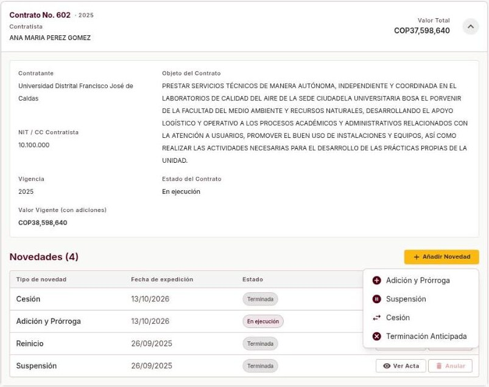

| Estado del contrato | Acciones disponibles |
|---|---|
| En ejecución | Adición y Prórroga, Suspensión, Cesión, Terminación Anticipada |
| Suspendido | Reinicio |
| Cesión pendiente de póliza | Agregar Póliza |
| Finalizado | Activar Contrato |
| Inicio, Sin acta de inicio, Cancelado, Terminado (Anticipado), Anulado, Liquidado | Ninguna: solo consulta |

Además:

- Si el contrato tiene una novedad **En trámite**, no se puede crear otra. En lugar del botón
  aparece "Hay una novedad en trámite: no se pueden crear nuevas novedades."
- Si usted es supervisor y el contrato no es suyo, el botón no aparece.
- Si se entra por un enlace directo a una novedad que el contrato no admite, el sistema lo devuelve
  al panel.

## 5. Cómo se crea una novedad (pasos comunes)

1. En la ficha del contrato, pulse **Añadir Novedad** y elija la novedad.
2. Se abre el formulario. A la izquierda queda la tarjeta **Información del Contrato** (tipo, número,
   objeto, valor, contratista, plazo inicial, fecha de iniciación, supervisor y ordenador del gasto).
   Si el contrato no tiene ordenador del gasto, aparece el aviso "No se encontró Ordenador del Gasto":
   vea [Problemas frecuentes](#16-problemas-frecuentes).

   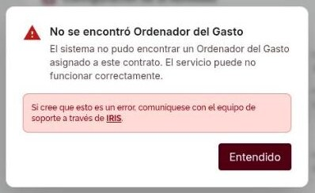

3. Llene **Datos de la Solicitud** y **Configuración de la Novedad** (los campos de cada novedad están
   en las secciones 6 a 11).
4. Opcional:
   - **Agregar Cláusula Adicional**: al activarlo, el texto de la cláusula pasa a ser obligatorio y se
     incluye en el acta. No aplica al reinicio.
   - **Tamaño de fuente documento**: tamaño de la letra del cuerpo del acta (10 por defecto; debe ser
     1 o más).
   - **Previsualizar Documento**: abre el acta en PDF en otra pestaña **sin registrar nada**. Exige el
     formulario completo.
5. Pulse **Crear Novedad**. Si falta algo, el formulario no avanza: marca los campos con error y lo
   lleva al primero.
6. Revise el resumen del diálogo **Confirmar Generación de Acta**. Si algún dato no coincide, pulse
   **Cancelar** y corrija, o repórtelo por IRIS.

   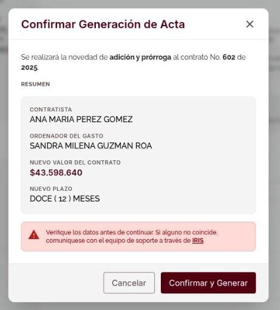

7. Pulse **Confirmar y Generar**. Espere sin cerrar ni recargar la página: el sistema genera el acta,
   la archiva y registra la novedad. Puede tardar hasta un minuto.
8. Al terminar aparece la pantalla de éxito con el **Resumen del Proceso**. **Volver al Seguimiento**
   lo regresa al panel con el contrato ya consultado, y la novedad nueva aparece en su historial.

   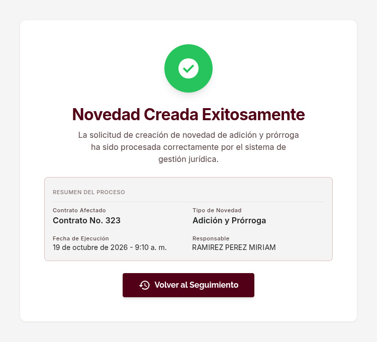

Si algo falla, aparece la pantalla de error ([sección 15](#15-errores-y-soporte)). El acta se genera
**antes** de registrar la novedad: si la generación falla, no queda nada registrado y puede corregir
y reintentar.

### Cómo se llenan los campos

- **Obligatorios**: llevan un asterisco rojo (`*`). Vacíos, muestran "Este campo es obligatorio.".
- **Fechas**: siempre en **dd/mm/aaaa**. Escriba solo los números (las barras se ponen solas) o use
  el icono de calendario. Una fecha incompleta o que no existe (31/02) muestra "Fecha incompleta o
  inexistente (dd/mm/aaaa).". Las fechas inician en la fecha de hoy, salvo las que el sistema
  calcula.
- **Valores en pesos**: llevan el símbolo `$` y se ven con puntos de miles (1.500.000). Solo pesos
  enteros, sin decimales ni signo negativo.
- **Campos calculados**: algunos (período de una suspensión, fecha de reinicio, terminación del
  cedente, nuevo valor, nuevo plazo, saldo del cesionario) los calcula el sistema y no se editan.
- Los mensajes de error aparecen mientras escribe, sin necesidad de salir del campo.
- **Limpiar** borra lo digitado en el formulario.

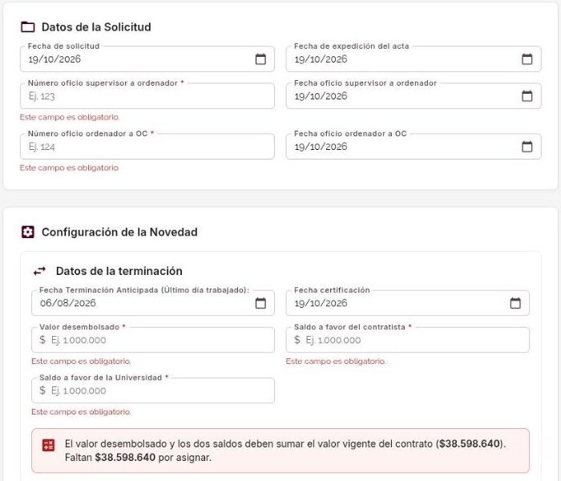

## 6. Adición y Prórroga

Aumenta el valor del contrato y extiende su plazo. **Las dos partes son obligatorias.** Disponible
con el contrato En ejecución.

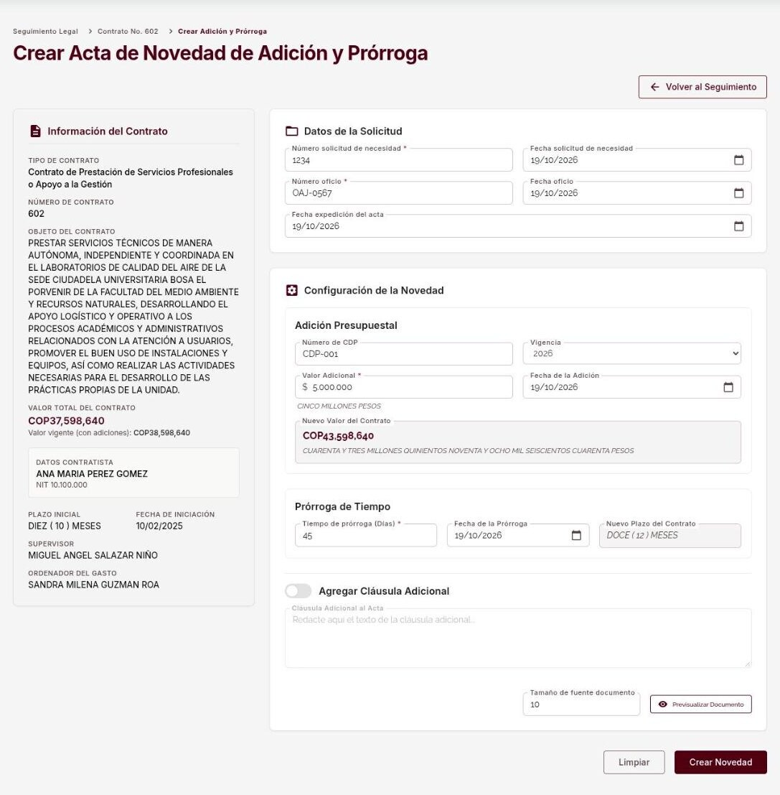

**Datos de la Solicitud**

| Campo | Obligatorio | Notas |
|---|---|---|
| Número solicitud de necesidad | Sí | |
| Fecha solicitud de necesidad | | |
| Número oficio | Sí | |
| Fecha oficio | | |
| Fecha expedición del acta | | |

**Adición Presupuestal**

| Campo | Obligatorio | Notas |
|---|---|---|
| Número de CDP | | Admite letras y guiones (por ejemplo, CDP-001) |
| Vigencia | | Año del CDP |
| Valor Adicional | Sí | Debajo se muestra en letras. **Tope legal**: máximo el 50 % del valor vigente del contrato |
| Fecha de la Adición | | |
| Nuevo Valor del Contrato | Calculado | Valor vigente + valor adicional, en números y en letras |

**Prórroga de Tiempo**

| Campo | Obligatorio | Notas |
|---|---|---|
| Tiempo de prórroga (Días) | Sí | **Tope legal**: máximo el 50 % del plazo vigente, en días |
| Fecha de la Prórroga | | |
| Nuevo Plazo del Contrato | Calculado | Plazo vigente + días de prórroga, en letras y números ("DIEZ ( 10 ) MESES Y QUINCE ( 15 ) DÍAS") |

- El valor vigente y el plazo vigente ya incluyen las adiciones y prórrogas anteriores.
- Para los plazos, un mes cuenta como 30 días.
- Si supera un tope, el campo muestra el máximo permitido y el formulario no avanza.

El contrato sigue En ejecución.

## 7. Suspensión

Pausa temporalmente la ejecución del contrato. Disponible con el contrato En ejecución.

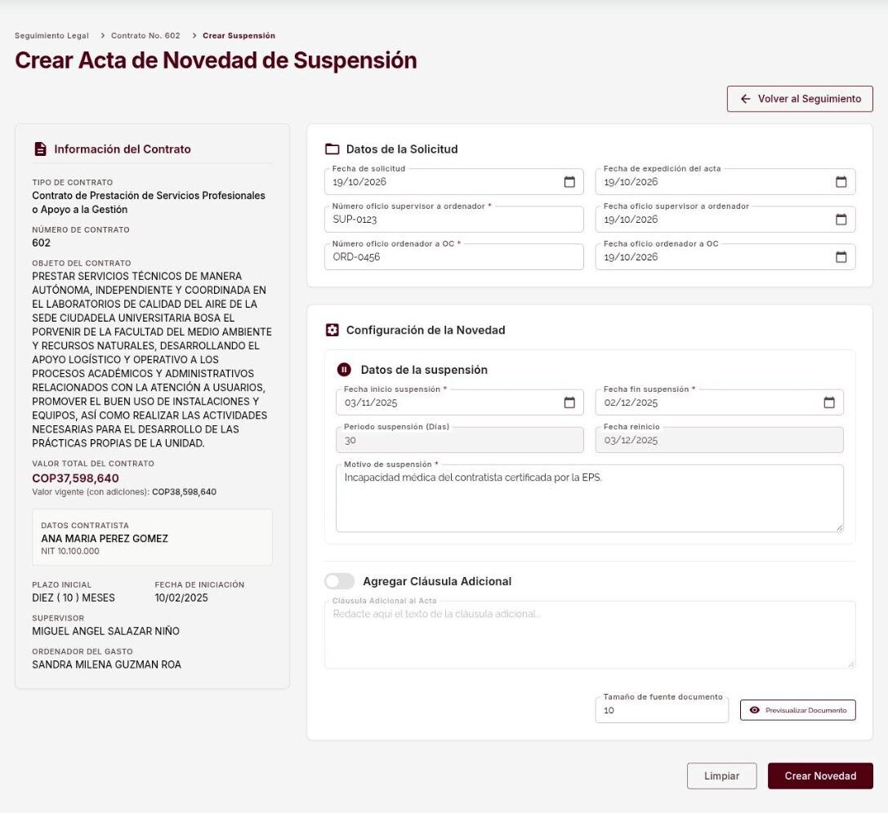

**Datos de la Solicitud**: Fecha de solicitud, Fecha de expedición del acta, **Número oficio
supervisor a ordenador** (obligatorio), Fecha oficio supervisor a ordenador, **Número oficio
ordenador a OC** (obligatorio) y Fecha oficio ordenador a OC. Cesión y Terminación Anticipada
piden estos mismos datos.

**Datos de la suspensión**

| Campo | Obligatorio | Notas |
|---|---|---|
| Fecha inicio suspensión | Sí | No puede ser anterior al día siguiente al inicio del contrato |
| Fecha fin suspensión | Sí | Posterior a la de inicio (mínimo 1 día de suspensión) y no después del fin vigente del contrato, que es su valor inicial |
| Periodo suspensión (Días) | Calculado | Días entre inicio y fin |
| Fecha reinicio | Calculado | Día siguiente al fin de la suspensión |
| Motivo de suspensión | Sí | Hasta 249 caracteres |

Al registrarla, el contrato pasa a **Suspendido** y su única acción disponible es el Reinicio.

## 8. Reinicio

Levanta la suspensión vigente. Disponible solo con el contrato **Suspendido**.

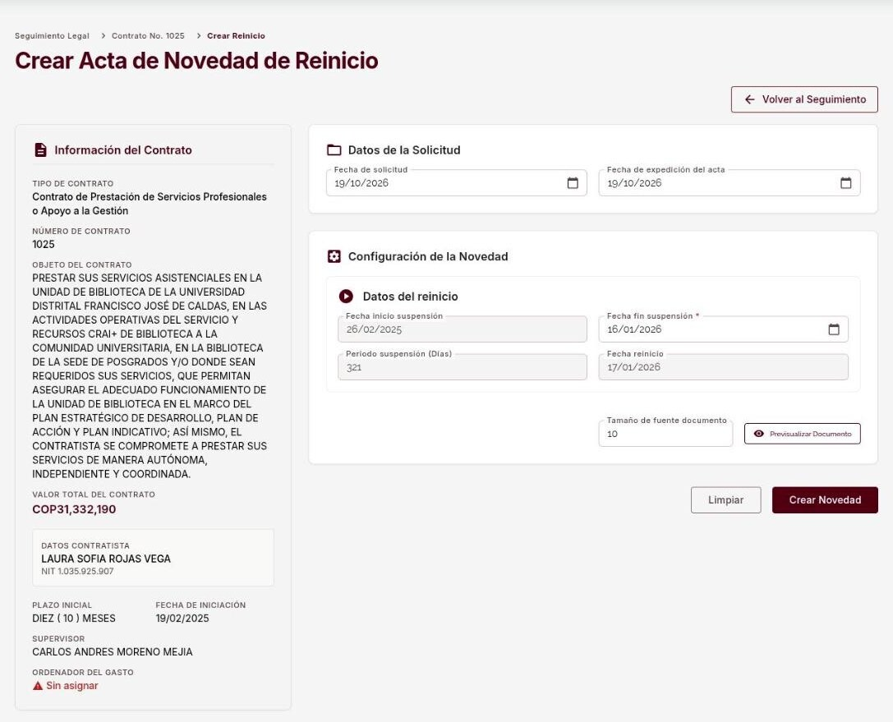

**Datos de la Solicitud**: Fecha de solicitud y Fecha de expedición del acta.

**Datos del reinicio**

| Campo | Obligatorio | Notas |
|---|---|---|
| Fecha inicio suspensión | Calculado | La de la suspensión que se levanta |
| Fecha fin suspensión | Sí | Inicia en el fin registrado en la suspensión. Puede adelantarse (reinicio anticipado), pero no ser antes del día siguiente al inicio ni después de ese fin |
| Periodo suspensión (Días) | Calculado | |
| Fecha reinicio | Calculado | Día siguiente al fin de la suspensión |

El reinicio no tiene cláusula adicional. Al registrarlo, el contrato vuelve a **En ejecución**.

## 9. Cesión

Transfiere el contrato a un nuevo contratista (el **cesionario**). Disponible con el contrato En
ejecución.

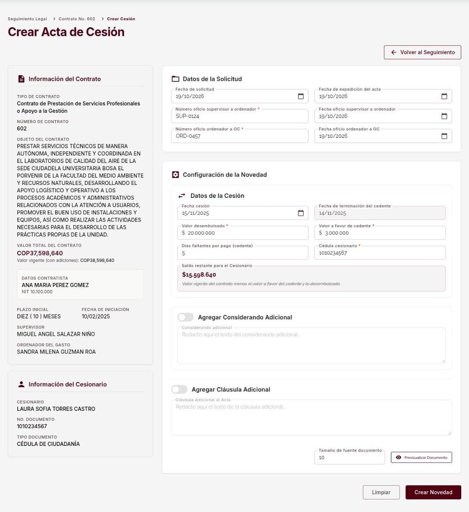

**Datos de la Solicitud**: los mismos de la suspensión ([sección 7](#7-suspensión)).

**Datos de la Cesión**

| Campo | Obligatorio | Notas |
|---|---|---|
| Fecha cesión | | No puede ser posterior al fin vigente del contrato |
| Fecha de terminación del cedente | Calculado | Día anterior a la cesión |
| Valor desembolsado | Sí | No puede superar el valor vigente del contrato |
| Valor a favor de cedente | Sí | No puede superar el valor vigente del contrato |
| Días faltantes por pago (cedente) | | Número entero, 1 o más |
| Cédula cesionario | Sí | Escriba el documento y **elija una opción de la lista**: un documento escrito sin elegirlo no vale. Solo aparecen personas naturales |
| Saldo restante para el Cesionario | Calculado | Valor vigente − (valor a favor del cedente + valor desembolsado). Sale en rojo si es negativo |

- Al elegir el cesionario, la tarjeta **Información del Cesionario** muestra su nombre, documento y
  tipo de documento.

  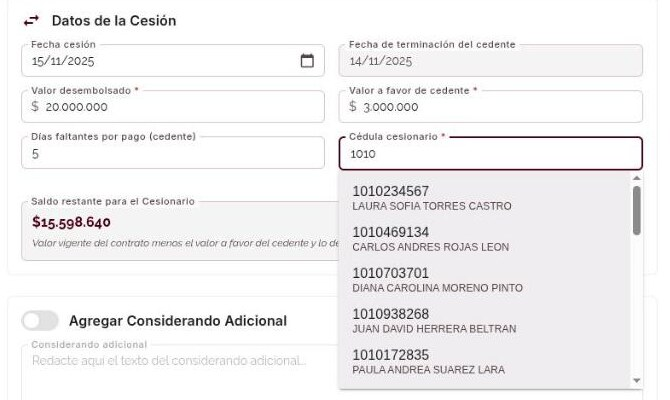

- **Agregar Considerando Adicional** (opcional): al activarlo, el texto del considerando pasa a ser
  obligatorio y se incluye en el acta.

Al registrarla, el contrato queda en **Cesión pendiente de póliza**: no admite otras novedades hasta
registrar la póliza del cesionario ([sección 11](#11-registrar-la-póliza-del-cesionario)).

## 10. Terminación Anticipada

Liquidación bilateral del contrato antes de su plazo. Disponible con el contrato En ejecución.

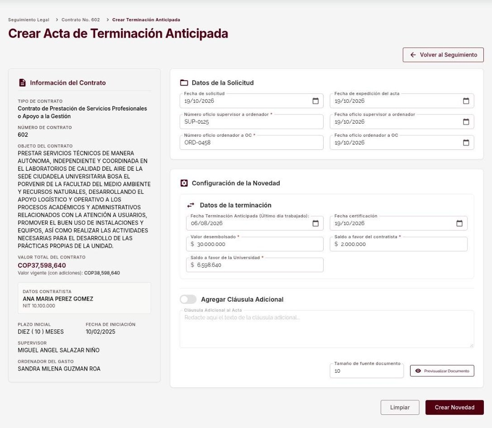

**Datos de la Solicitud**: los mismos de la suspensión ([sección 7](#7-suspensión)).

**Datos de la terminación**

| Campo | Obligatorio | Notas |
|---|---|---|
| Fecha Terminación Anticipada (Último día trabajado) | | A más tardar el día anterior al fin vigente del contrato, que es su valor inicial: terminar el último día no sería anticipada |
| Fecha certificación | | |
| Valor desembolsado | Sí | Lo ya pagado |
| Saldo a favor del contratista | Sí | Lo ejecutado y pendiente de pago |
| Saldo a favor de la Universidad | Sí | Lo no ejecutado, que vuelve a la Universidad |

- **Los tres valores deben sumar exactamente el valor vigente del contrato**, y ninguno puede
  superarlo.
- Mientras no cuadren, un aviso indica la diferencia ("Faltan $X por asignar" o "Se exceden en $X") y
  el formulario no avanza.

  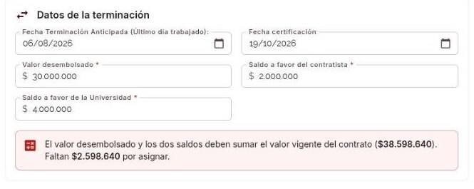

- El saldo a favor de la Universidad se completa solo con lo que falta, hasta que usted lo edite.
- Los tres valores pueden ser mayores que cero a la vez.

Al registrarla, el contrato pasa a **Terminado (Anticipado)**.

## 11. Registrar la póliza del cesionario

Completa la póliza del nuevo contratista después de una cesión. Disponible con el contrato en
**Cesión pendiente de póliza**, desde **Añadir Novedad › Agregar Póliza**.

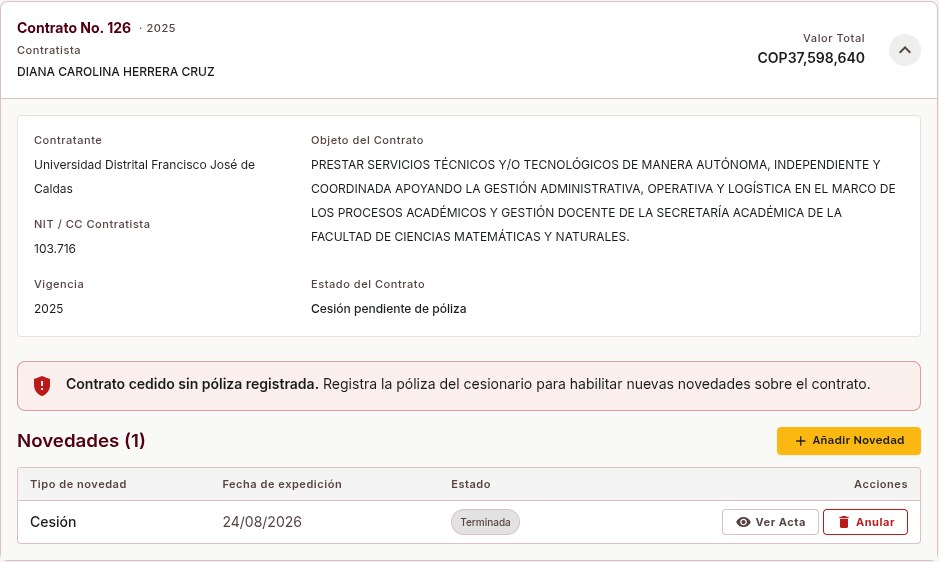

| Campo | Obligatorio | Notas |
|---|---|---|
| Entidad Aseguradora | Sí | Lista de aseguradoras |
| Número de Póliza | Sí | El que asigna la aseguradora |

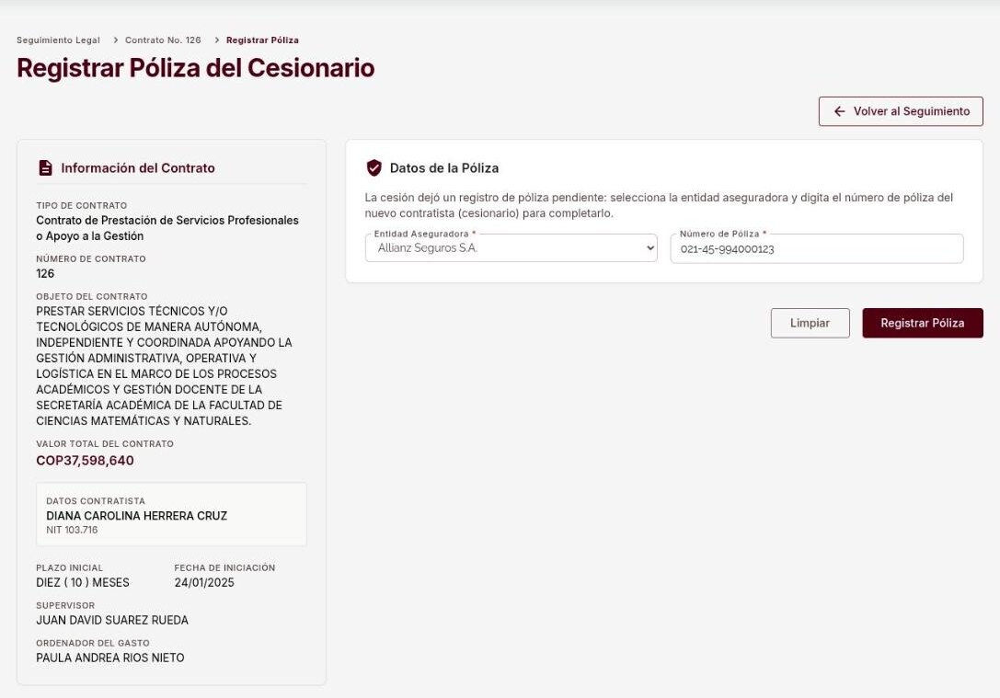

- Si la póliza ya tenía datos, el formulario los trae precargados y el registro los actualiza.
- Pulse **Registrar Póliza** y confirme el resumen (cesionario, aseguradora y número de póliza).

  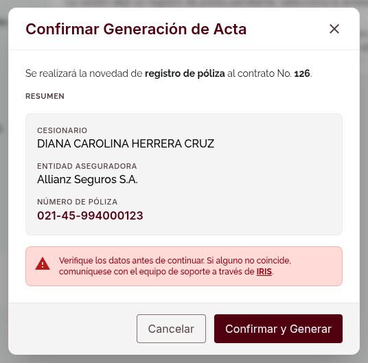

Al registrarla, el contrato vuelve a **En ejecución** con sus cuatro novedades disponibles.

## 12. Ver el acta de una novedad

En el historial de la ficha del contrato, **Ver Acta** abre el PDF archivado en otra pestaña.

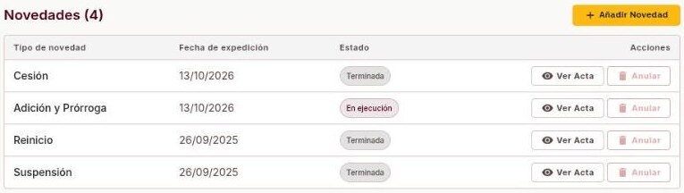

- El botón está desactivado ("Sin acta registrada") en las novedades que no tienen acta archivada.
- Las novedades registradas antes del 27 de agosto de 2026 no tienen el PDF guardado: en ellas el
  botón está desactivado o, al pulsarlo, muestra un error.
- Si el navegador bloquea ventanas emergentes, permítalas para el portal.

## 13. Anular una novedad

La anulación revierte un error reciente de digitación; no deshace la historia jurídica del contrato.
Por eso el botón **Anular** solo está activo si se cumplen las dos condiciones:

1. **El contrato tiene una sola novedad.** Si ya tiene dos o más, ninguna es anulable, tampoco la
   última.
2. **Esa novedad corresponde al estado actual del contrato**:

| Estado del contrato | Novedad anulable |
|---|---|
| Suspendido | La suspensión |
| Cesión pendiente de póliza | La cesión |
| Terminado (Anticipado) o Finalizado | La terminación anticipada |
| En ejecución | Una adición y prórroga, o una cesión cuya póliza ya se registró |

Para anular, pulse **Anular**, revise los datos del diálogo **Confirmar Anulación** (contrato,
vigencia, tipo, fecha y estado) y pulse **Confirmar Anulación**. El contrato vuelve a **En
ejecución**. La anulación queda registrada de forma permanente en el historial.

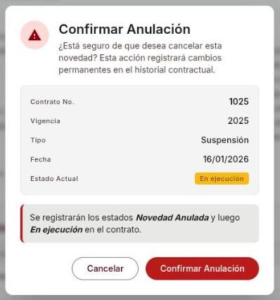

## 14. Activar un contrato finalizado

Reabre administrativamente un contrato **Finalizado**.

1. En su ficha, pulse **Añadir Novedad › Activar Contrato**.
2. Confirme en el diálogo **Activar Contrato**.

   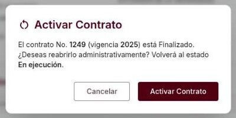

El contrato vuelve a **En ejecución**. Esta acción no genera acta.

## 15. Errores y soporte

Cuando una operación falla, la pantalla de error muestra:

- **Código de error**: identifica el tipo de falla (tabla abajo).
- La explicación y, cuando aplica, el **Servicio** donde ocurrió y qué hacer.
- **Copiar error**: copia un bloque con el trámite, el código, el detalle, el servicio y la fecha,
  listo para pegar en el caso de soporte.
- **Reintentar**: repite la operación con los mismos datos.
- **Contactar Soporte**: abre la mesa de ayuda **IRIS** en otra pestaña.
- **Volver al Panel de Gestión**.

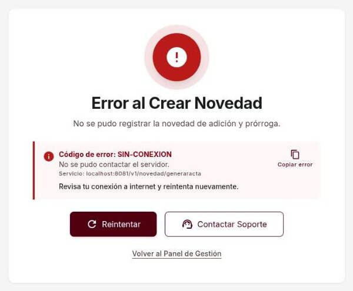

| Código | Qué significa | Qué hacer |
|---|---|---|
| `SIN-CONEXION` | No se pudo contactar el servidor | Revise su conexión y reintente |
| `401-SESION` | La sesión expiró | Inicie sesión de nuevo en el portal y reintente |
| `403-PERMISO` | Su usuario no tiene permiso para esa operación | Verifique con la Oficina Asesora Jurídica que su rol permita el trámite |
| `404-NO-ENCONTRADO` | El servicio no encontró el contrato o la novedad | Vuelva al panel y busque el contrato de nuevo |
| `409-CONFLICTO` | El estado del contrato cambió y ya no admite la novedad | Vuelva al panel para ver el estado actual |
| `400-DATOS`, `422-DATOS` | El servicio rechazó los datos enviados (el detalle dice cuál y por qué) | Corrija el formulario; si los datos son correctos, reporte el código |
| `5xx-SERVIDOR` (500, 502, 504…) | Falló un servicio institucional | Reintente en unos minutos; si persiste, reporte el código |
| Otro `NNN-HTTP` | Respuesta inesperada del servicio | Reintente; si se repite, repórtelo |
| `OPERACION-RECHAZADA` | El sistema detuvo el trámite y el detalle dice por qué (por ejemplo, falta un dato del contrato) | Siga lo que indica el detalle |
| `DESCONOCIDO` | Error no identificado | Reintente; si se repite, repórtelo |

Dos mensajes piden atención especial:

- **"La operación superó el tiempo límite y se canceló."** Antes de reintentar, vuelva al panel y
  revise si la novedad quedó en el historial del contrato, para no registrarla dos veces.
- **"ATENCIÓN: la novedad quedó registrada sin replicar…"** **No reintente.** Repórtelo por IRIS
  con el número del contrato: reintentar la duplicaría.

Si el fallo es en otro sistema institucional, la novedad se desactiva sola, y la pantalla lo informa
con el código del error: puede reintentar con normalidad.

## 16. Problemas frecuentes

| Situación | Causa y solución |
|---|---|
| No aparece **Añadir Novedad** | El estado del contrato no admite novedades ([sección 4](#4-qué-se-puede-hacer-según-el-estado-del-contrato)), hay una novedad en trámite, o usted es supervisor de otro contrato |
| **Anular** está desactivado | El contrato tiene más de una novedad, o la novedad no corresponde a su estado ([sección 13](#13-anular-una-novedad)). Si usted es supervisor de otro contrato, el botón ni siquiera aparece |
| Aviso "No se encontró Ordenador del Gasto" al abrir un formulario | El contrato no tiene ordenador del gasto asignado y el acta lo exige. En adición y prórroga no deja confirmar; en las demás novedades, el servicio puede rechazar el acta. Repórtelo por IRIS |
| Una fecha "cambió" al escribirla | Las fechas van en dd/mm/aaaa: día primero, luego mes |
| **Previsualizar Documento** no hace nada | Falta un campo obligatorio (quedan marcados) o el tamaño de letra es menor que 1 |
| **Ver Acta** desactivado o con error | La novedad no tiene acta archivada ([sección 12](#12-ver-el-acta-de-una-novedad)) |
